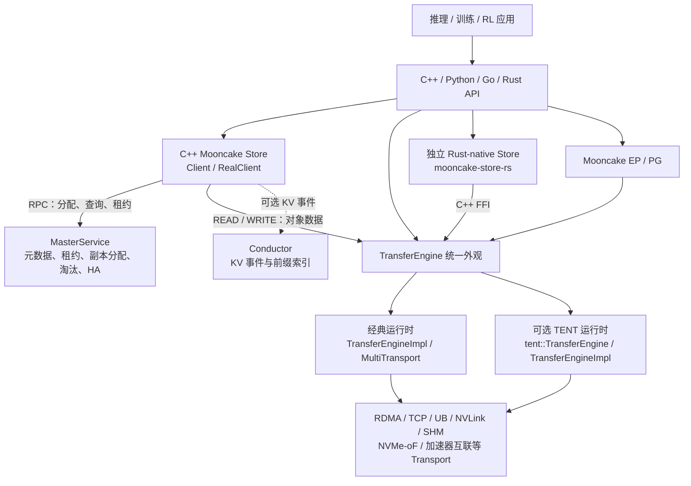
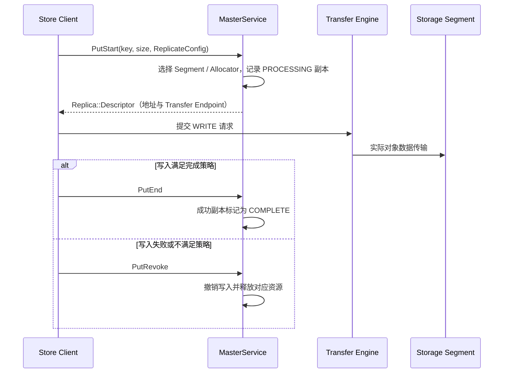

# Mooncake 代码架构分析

## 1. 分析范围

本文基于当前仓库源码，梳理 Mooncake 的模块划分、核心调用链、语言绑定、扩展组件以及构建与测试结构，重点关注以下两条主线：

- **数据面**：Transfer Engine 如何屏蔽网络、内存和加速器差异，执行批量数据传输。
- **存储控制面与数据面**：Mooncake Store 如何由 Master 管理元数据和副本分配，再由 Client 通过 Transfer Engine 搬运对象数据。

仓库同时包含独立 Rust Store、EP/PG、Conductor、P2P Store 和多种语言绑定。本文会明确区分**核心实现、独立实现、语言绑定和辅助组件**，避免仅按目录名称推断依赖关系。本文是静态代码分析，不包含运行时性能验证。

## 2. 总体架构

Mooncake 的核心不是单一服务，而是一组可组合的数据移动与 KV Cache 基础设施：

- Transfer Engine 提供统一的数据传输能力，是 Store、P2P Store、EP/PG 等组件的重要底层依赖。
- C++ Mooncake Store 在 Transfer Engine 之上增加对象元数据、副本、租约、分配、淘汰和多层存储管理。
- Python、Go、Rust 接口将原生能力暴露给推理、训练和 RL 系统。
- Conductor、EP/PG、Reshard 等组件按需启用，不是每一次 Store 或 Transfer Engine 部署的必需环节。



最关键的结构边界是：**Master 不代理对象数据**。Master 负责决定“数据放在哪里、副本处于什么状态”，Client 和 Transfer Engine 负责实际的数据读写。

## 3. 仓库模块地图

| 目录 | 定位 | 主要内容与依赖 |
| --- | --- | --- |
| [`mooncake-transfer-engine/`](../mooncake-transfer-engine/) | 核心 C++ 数据传输引擎 | 公共 API、经典批量传输运行时、可选 TENT、Topology、Metadata 及多种 Transport。 |
| [`mooncake-store/`](../mooncake-store/) | 核心 C++ 分布式对象与 KV Cache 存储 | Client、Master、RPC、副本分配、Segment、租约、淘汰、HA、本地及分布式存储后端；复用 Transfer Engine。 |
| [`mooncake-store-rs/`](../mooncake-store-rs/) | 独立 Rust-native Store | 独立实现客户端控制面、路由、租约、放置和冷热层，通过 C++ FFI 使用 TE/TENT；不是 C++ Store 的简单绑定。 |
| [`mooncake-common/`](../mooncake-common/) | 公共基础库 | 配置、环境解析、校验、Asio/RPC 支撑，以及可选 etcd、Kubernetes Lease Go wrapper。 |
| [`mooncake-integration/`](../mooncake-integration/) | C++ 到 Python 的绑定层 | 生成 `engine`、`_store`、`_conductor` 等 pybind11 扩展，不包含另一套传输或存储实现。 |
| [`python/mooncake/`](../python/mooncake/) | 主 Python 包源码 | Store facade、异步 Store、结构化对象、CLI、EP、Conductor 等高层接口。 |
| [`mooncake-conductor/`](../mooncake-conductor/) | 可选路由辅助服务 | 消费 KV 事件，维护前缀索引并提供路由查询；不链接 Transfer Engine。 |
| [`mooncake-ep/`](../mooncake-ep/) | MoE 专家并行数据面 | C++/CUDA/SYCL 的 dispatch、combine 和弹性 EP，使用 TE 设备传输能力，不依赖 Store。 |
| [`mooncake-pg/`](../mooncake-pg/) | 集合通信与故障恢复 | Communicator、控制面、设备通信和 PyTorch ProcessGroup 适配；数据面使用 TE。 |
| [`mooncake-p2p-store/`](../mooncake-p2p-store/) | 可选无 Master P2P 对象分发 | Go/cgo 实现，通过 TE C ABI 传输，使用 etcd 保存元数据，适合 checkpoint 等副本传播。 |
| [`mooncake-reshard/`](../mooncake-reshard/) | Python 放置规划与迁移辅助库 | 规划权重和 KV Cache 迁移；TE executor 执行实时迁移，Store 适配器处理快照。 |
| [`mooncake-rl/`](../mooncake-rl/) | RL 使用示例 | 通过 Store 的张量接口演示 rollout 与训练数据交换，不是独立 RL 运行时。 |
| [`mooncake-wheel/`](../mooncake-wheel/) | 打包与兼容代码 | 传统 wheel 构建入口、尚未迁移的 Python 模块及打包测试资源。 |
| [`benchmarks/`](../benchmarks/) | 场景压测 | KV Cache trace、XYPD 等场景测试；组件目录还包含更贴近原生实现的 benchmark。 |
| [`scripts/`](../scripts/) | 构建、CI 与端到端编排 | 构建、安装验证、服务启动、测试和 wheel 发布脚本。 |
| [`docker/`](../docker/) | 镜像构建 | 源码构建镜像和基于已发布 wheel 的运行镜像。 |
| [`monitoring/`](../monitoring/) | 可观测性示例 | Prometheus、Grafana 和 Docker Compose 配置，不参与核心数据面。 |
| [`docs/`](../docs/) | 用户与设计文档 | Sphinx/MyST 文档源、部署指南、API 和设计说明。 |

## 4. Transfer Engine 核心架构

### 4.1 公共 API 与经典运行时

公共入口是 [`transfer_engine.h`](../mooncake-transfer-engine/include/transfer_engine.h) 中的 `mooncake::TransferEngine`，主要接口包括：

- 初始化与资源管理：`init()`、`freeEngine()`。
- Segment 与内存：`openSegment()`、`registerLocalMemory()`、`unregisterLocalMemory()`。
- 批次生命周期：`allocateBatchID()`、`submitTransfer()`、`getTransferStatus()`、`freeBatchID()`。
- 通知与状态：`sendNotifyByName()`、`probePeerAliveByID()`、`getNicLoadStats()`。

经典运行时的主要调用链为：

```text
TransferEngine
    → TransferEngineImpl
    → MultiTransport
    → 具体 Transport
    → 网络、共享内存、存储或加速器实现
```

各层职责如下：

| 组件 | 源码位置 | 职责 |
| --- | --- | --- |
| `TransferEngine` | [`include/transfer_engine.h`](../mooncake-transfer-engine/include/transfer_engine.h)、[`src/transfer_engine.cpp`](../mooncake-transfer-engine/src/transfer_engine.cpp) | 对外稳定入口，负责生命周期和内部实现转发，也可承载 TENT 实现。 |
| `TransferEngineImpl` | [`src/transfer_engine_impl.cpp`](../mooncake-transfer-engine/src/transfer_engine_impl.cpp) | 装配 Metadata、Topology、MultiTransport 和具体传输协议。 |
| `MultiTransport` | [`include/multi_transport.h`](../mooncake-transfer-engine/include/multi_transport.h)、[`src/multi_transport.cpp`](../mooncake-transfer-engine/src/multi_transport.cpp) | 管理 `BatchDesc`，按请求选择 Transport，拆分任务并聚合批次状态。 |
| `Transport` | [`include/transport/transport.h`](../mooncake-transfer-engine/include/transport/transport.h) | 定义 Segment、Buffer、Batch、TransferTask 和提交/状态查询等通用契约。 |
| `TransferMetadata` | [`include/transfer_metadata.h`](../mooncake-transfer-engine/include/transfer_metadata.h)、[`src/transfer_metadata.cpp`](../mooncake-transfer-engine/src/transfer_metadata.cpp) | 管理 Segment、Buffer、Device、RPC 描述及缓存和握手信息。 |
| `Topology` | [`include/topology.h`](../mooncake-transfer-engine/include/topology.h)、[`src/topology.cpp`](../mooncake-transfer-engine/src/topology.cpp) | 发现和解析拓扑，根据 preferred/available HCA 等条件选择设备。 |

具体协议实现集中在 [`src/transport/`](../mooncake-transfer-engine/src/transport/)，包括 RDMA、TCP、UB、NVMe-oF、SHM、NVLink、Ascend、EFA 等。多数硬件或协议后端由编译开关控制，因此“仓库中存在源码”不等于“当前构建已启用”。

经典批量传输主流程为：

1. 注册本地内存，并按配置更新 Segment/Buffer 元数据。
2. 通过 `openSegment()` 获取远端 Segment 描述并建立访问能力。
3. 通过 `allocateBatchID()` 创建批次。
4. `submitTransfer()` 根据目标协议和 Buffer 地址选择 Transport，生成任务或 Slice 并提交。
5. 通过状态接口查询单个任务或整个批次。
6. 传输完成且缓冲区不再需要保护后，通过 `freeBatchID()` 清理批次。

### 4.2 可选 TENT 运行时

TENT 位于 [`mooncake-transfer-engine/tent/`](../mooncake-transfer-engine/tent/)，不是经典 `MultiTransport` 下的一个普通协议插件，而是可以承载同一外观 API 的另一套运行时。

| 维度 | 经典运行时 | TENT 运行时 |
| --- | --- | --- |
| 内部入口 | `TransferEngineImpl` | `tent::TransferEngine` → `tent::TransferEngineImpl` |
| 协议选择 | `MultiTransport` 选择具体 Transport | `TransportSelector` 生成有序候选 Transport、设备掩码和 QP pool |
| Segment 元数据 | `TransferMetadata` 及元数据插件 | `SegmentManager`、P2P/Central `SegmentRegistry`、`MetaStore` |
| 提交与推进 | 批次拆分后交由具体 Transport | `prepareSubmit()`、`commitPreparedSubmit()`，可经过准入队列、staging 和 `ProgressWorker` |
| 故障处理 | 由经典 Transport 路径处理 | 可通过 `resubmitTransferTask()` 切换候选 Transport；RDMA 路径支持逐 Slice 换路 |
| RDMA 路径 | 经典任务与 Slice 实现 | `planRdmaSlices()` 分片，多 NIC 选择结合 EWMA 负载、NUMA 和设备掩码 |

TENT 的关键源码入口：

- 公共 API：[`tent/include/tent/transfer_engine.h`](../mooncake-transfer-engine/tent/include/tent/transfer_engine.h)。
- 提交与重试：[`tent/src/runtime/transfer_engine_impl.cpp`](../mooncake-transfer-engine/tent/src/runtime/transfer_engine_impl.cpp)。
- 控制面 RPC：[`tent/src/runtime/control_plane.cpp`](../mooncake-transfer-engine/tent/src/runtime/control_plane.cpp)。
- Segment 缓存与注册：[`tent/src/runtime/segment_manager.cpp`](../mooncake-transfer-engine/tent/src/runtime/segment_manager.cpp)、[`tent/src/runtime/segment_registry.cpp`](../mooncake-transfer-engine/tent/src/runtime/segment_registry.cpp)。
- 路径选择：[`tent/src/runtime/transport_selector.cpp`](../mooncake-transfer-engine/tent/src/runtime/transport_selector.cpp)。
- RDMA 分片与 worker：[`tent/src/transport/rdma/`](../mooncake-transfer-engine/tent/src/transport/rdma/)。

顶层 `USE_TENT` 默认关闭。编译启用后，经典 `mooncake::TransferEngine` 可通过运行时环境配置选择 TENT；兼容层负责调用转发和错误映射，但部分经典接口在 TENT 模式下行为不同或不可用，迁移时不能只验证编译是否通过。

TENT 还提供独立的 C API 和 Python 绑定，入口分别位于 [`tent/src/transfer_engine_c.cpp`](../mooncake-transfer-engine/tent/src/transfer_engine_c.cpp) 与 [`tent/src/python/pybind.cpp`](../mooncake-transfer-engine/tent/src/python/pybind.cpp)。

## 5. C++ Mooncake Store 架构

### 5.1 模块职责

| 模块 | 关键源码 | 职责 |
| --- | --- | --- |
| 外层 Client API | [`include/real_client.h`](../mooncake-store/include/real_client.h)、[`src/real_client.cpp`](../mooncake-store/src/real_client.cpp) | 对外对象存储接口、客户端缓冲区、Segment 挂载和生命周期封装。 |
| 核心 Client | [`include/client_service.h`](../mooncake-store/include/client_service.h)、[`src/client_service.cpp`](../mooncake-store/src/client_service.cpp) | Put/Get/Batch、读副本选择、校验、存储后端和传输协调。 |
| Master RPC Client | [`include/master_client.h`](../mooncake-store/include/master_client.h)、[`src/master_client.cpp`](../mooncake-store/src/master_client.cpp) | 将分配、查询、租约和状态变更请求发送到 Master。 |
| RPC 服务 | [`src/rpc_service.cpp`](../mooncake-store/src/rpc_service.cpp) | 注册 YLT `coro_rpc` 服务，通过 `WrappedMasterService` 暴露 Master 能力。 |
| Master 核心 | [`include/master_service.h`](../mooncake-store/include/master_service.h)、[`src/master_service.cpp`](../mooncake-store/src/master_service.cpp) | Segment 生命周期、对象元数据、租约、副本分配、淘汰、配额和后台任务。 |
| 分配策略 | [`include/allocation_strategy.h`](../mooncake-store/include/allocation_strategy.h) | Random、Free Ratio、Local First、CXL 等副本放置策略。 |
| Segment 与 Allocator | [`include/segment.h`](../mooncake-store/include/segment.h)、[`include/allocator.h`](../mooncake-store/include/allocator.h) | 管理可服务 Segment、挂载状态和 Buffer Allocator，生成副本描述。 |
| 元数据与 HA | [`include/object_metadata.h`](../mooncake-store/include/object_metadata.h)、[`include/metadata/`](../mooncake-store/include/metadata/)、[`include/ha/`](../mooncake-store/include/ha/) | 主 Master 对象状态、命名空间元数据，以及 Standby、快照、OpLog 和领导协调能力。 |
| Client 数据提交 | [`include/transfer_task.h`](../mooncake-store/include/transfer_task.h)、[`src/transfer_task.cpp`](../mooncake-store/src/transfer_task.cpp) | 将 Store 操作转成 Transfer Engine 的 READ/WRITE，并管理 Future、状态和批次。 |
| 其他存储路径 | [`src/storage/`](../mooncake-store/src/storage/)、[`src/nvme_kv/`](../mooncake-store/src/nvme_kv/)、[`src/nof/`](../mooncake-store/src/nof/) | 文件、分布式存储、NVMe KV、NoF 等可选或专用路径。 |

主要可执行入口包括：

- [`src/master.cpp`](../mooncake-store/src/master.cpp)：`mooncake_master`。
- [`src/real_client_main.cpp`](../mooncake-store/src/real_client_main.cpp)：`mooncake_client`。

完整 `mooncake_store` 目标链接 `transfer_engine`；Master 侧目标可以与 Client 数据面分离构建，符合控制面和数据面解耦的设计。

### 5.2 Put：控制面与数据面分离



`Client::Create()` 可以注入已有 `TransferEngine`，也可以创建并初始化新引擎。内存副本根据同进程等条件选择 memcpy 或 Transfer Engine；文件、NoF、DFS 等副本具有各自的数据路径。

### 5.3 Get：先取元数据，再读取数据

1. Client 通过 Query 或副本列表接口获取可用副本、读租约和校验信息。
2. 读副本选择器从完整副本中选择合适目标。
3. Client 通过 Transfer Engine 执行 READ，或进入文件、NoF、DFS 等专用读取路径。
4. 根据配置和元数据校验对象 checksum，完成读取。

因此，Master 的 RPC 次数和对象数据带宽不是同一层面的指标：前者属于控制面，后者主要由 Client、Transfer Engine、目标 Segment 和存储后端决定。

节点选择与分配策略的进一步分析见 [Mooncake Store 数据写入的节点选择机制](./mooncake-store-node-selection.md)。

## 6. 语言绑定与对外接口

### 6.1 绑定层次

| 接口 | 实现位置 | 底层实现与边界 |
| --- | --- | --- |
| Python `engine` | [`mooncake-integration/transfer_engine/transfer_engine_py.cpp`](../mooncake-integration/transfer_engine/transfer_engine_py.cpp) | pybind11 包装 C++ Transfer Engine。 |
| Python `_store` | [`mooncake-integration/store/store_py.cpp`](../mooncake-integration/store/store_py.cpp) | pybind11 包装 C++ Mooncake Store。 |
| Python `_conductor` | [`mooncake-integration/conductor/conductor_py.cpp`](../mooncake-integration/conductor/conductor_py.cpp) | pybind11 包装 Conductor C++ core。 |
| Python 高层 Store | [`python/mooncake/store/`](../python/mooncake/store/) | 默认使用 `_store`；设置 `MOONCAKE_STORE_BACKEND=rs` 时可切换独立 Rust Store 适配层。 |
| Python `_ep` | [`mooncake-ep/src/ep_py.cpp`](../mooncake-ep/src/ep_py.cpp) | 导出 EP 的 `Buffer`、`ElasticBuffer` 等原生能力。 |
| Python PG | [`mooncake-pg/torch/src/pg_py.cpp`](../mooncake-pg/torch/src/pg_py.cpp) | PyTorch ProcessGroup 适配层，相关原生代码按当前设计运行时 JIT 构建。 |
| Store C ABI | [`mooncake-store/include/store_c.h`](../mooncake-store/include/store_c.h)、[`mooncake-store/src/store_c.cpp`](../mooncake-store/src/store_c.cpp) | 为 Go、Rust 和动态加载消费者提供稳定 C 边界。 |
| Go Store | [`mooncake-store/go/`](../mooncake-store/go/) | cgo 包装 Store C ABI。 |
| Rust Store binding | [`mooncake-store/rust/`](../mooncake-store/rust/) | 包装 C++ Store C ABI，支持链接或动态加载；不同于 `mooncake-store-rs`。 |
| Rust-native Store Python | [`mooncake-store-rs/crates/mooncake-store-py/`](../mooncake-store-rs/crates/mooncake-store-py/) | PyO3 绑定独立 Rust Store。 |

### 6.2 Python CLI 入口

根 [`pyproject.toml`](../pyproject.toml) 注册了主要命令：

| 命令 | Python 入口 | 作用 |
| --- | --- | --- |
| `mooncake_master` | `mooncake.cli:main` | 启动 Store Master。 |
| `mooncake_client` | `mooncake.cli_client:main` | 启动 Store Client。 |
| `transfer_engine_bench` | `mooncake.cli_bench:main` | Transfer Engine 压测。 |
| `mooncake_http_metadata_server` | `mooncake.http_metadata_server:main` | HTTP 元数据服务。 |
| `mc_store_rest_server` | `mooncake.mooncake_store_service:sync_main` | Store REST 服务。 |
| `transfer_engine_topology_dump` | `mooncake.transfer_engine_topology_dump:main` | 导出拓扑信息。 |
| `mooncake-store-rs-{client,admin,bench}` | `mooncake._launcher` | 启动独立 Rust Store 的客户端、管理和压测程序。 |

Python CLI 与原生可执行文件之间由 [`python/mooncake/_launcher.py`](../python/mooncake/_launcher.py) 等代码衔接，部分入口最终通过 `exec` 启动包内原生二进制。

## 7. 扩展组件的依赖边界

### 7.1 Conductor

[`mooncake-conductor/`](../mooncake-conductor/) 是可选 C++20 服务，入口为 [`src/main.cpp`](../mooncake-conductor/src/main.cpp)。`EventManager`、`ConductorService` 和 `PrefixCacheTable` 分别承担事件处理、查询服务和前缀索引。它消费 vLLM、SGLang、Store 等来源的 KV 事件，但不参与 Store 的对象数据传输。

其 Rust 目录是客户端绑定，不代表服务本身由 Rust 重写；Python 接口则通过 `mooncake-integration` 暴露。

### 7.2 EP 与 PG

- [`mooncake-ep/`](../mooncake-ep/) 提供 MoE dispatch/combine 和弹性 EP，核心包含设备 kernel、通信 Buffer 和 Python 原生绑定。
- [`mooncake-pg/`](../mooncake-pg/) 提供集合通信、P2P、动态成员及故障恢复，`MooncakeCommunicator` 和 Torch `MooncakeBackend` 分别对应通信核心与 PyTorch 集成。
- 两者可以使用 Transfer Engine 的设备传输能力，但不依赖 Mooncake Store，不能画成 Store 的上层存储功能。

### 7.3 独立 Store 与 P2P Store

- `mooncake-store/rust` 是 **C++ Store 的 Rust 绑定**。
- `mooncake-store-rs` 是 **独立 Rust-native Store 实现**，具有自己的客户端控制面和存储语义，通过 FFI 复用 TE/TENT。
- `mooncake-p2p-store` 是 **无 Master 的 Go/cgo P2P 对象分发库**，适用于与中心式 Store 不同的副本传播场景。

### 7.4 Reshard、RL 与监控

- Reshard 是按需组合的 Python 规划与执行适配库，不是常驻服务。
- `mooncake-rl` 当前主要提供基于 Store 张量接口的示例。
- Monitoring 仅提供运维配置示例，不属于运行时依赖。

## 8. 构建与发布架构

### 8.1 CMake 组件组合

根 [`CMakeLists.txt`](../CMakeLists.txt) 负责组合各组件，公共编译选项集中在 [`mooncake-common/common.cmake`](../mooncake-common/common.cmake)。主要开关如下：

| 开关 | 源码树默认值 | 影响 |
| --- | --- | --- |
| `WITH_TE` | `ON` | 构建 Transfer Engine。 |
| `WITH_STORE` | `ON` | 构建 C++ Mooncake Store。 |
| `WITH_STORE_RUST` | `ON` | 构建 C++ Store 的 Rust binding；PEP 517 wheel 配置默认关闭。 |
| `WITH_STORE_GO` | `OFF` | 构建 Go binding。 |
| `WITH_STORE_RS` | `OFF` | 构建独立 Rust-native Store。 |
| `WITH_CONDUCTOR` | `OFF` | 构建 Conductor。 |
| `WITH_EP` | `OFF` | 构建 EP/PG 相关能力。 |
| `WITH_P2P_STORE` | `OFF` | 构建 P2P Store。 |
| `USE_TENT` | `OFF` | 构建可选 TENT 运行时。 |
| `BUILD_UNIT_TESTS` | `ON` | 构建单元测试；PEP 517 wheel 配置默认关闭。 |
| `BUILD_BENCHMARK` | `ON` | 构建 benchmark；PEP 517 wheel 配置默认关闭。 |
| `USE_TCP` / `USE_HTTP` | `ON` | 默认启用 TCP Transport 和 HTTP 元数据支持。 |
| `USE_CUDA`、其他硬件开关 | 通常为 `OFF` | 按需启用 accelerator、RDMA 和厂商互联后端。 |

实际构建结果还受依赖库、平台、工具链及各模块内部条件判断影响，不能仅根据顶层默认值推断最终二进制能力。

### 8.2 Python wheel 构建链

标准 PEP 517 路径为：

```text
pip wheel .
    → pyproject.toml / scikit-build-core
    → 顶层 CMake（SKBUILD 模式）
    → 编译原生库与 Python 扩展
    → 安装 python component
    → 合并 python/mooncake、mooncake-wheel 中未迁移模块和 Reshard
    → 生成 mooncake-transfer-engine wheel
```

[`python/CMakeLists.txt`](../python/CMakeLists.txt) 负责 Python 包的安装组合；[`mooncake-integration/CMakeLists.txt`](../mooncake-integration/CMakeLists.txt) 负责主要 pybind11 扩展及其原生链接关系。

仓库还保留传统发布路径：先执行独立 CMake 构建，再由 [`scripts/build_wheel.sh`](../scripts/build_wheel.sh) 和 `mooncake-wheel` 的 setuptools 配置组装 wheel，最后通过 `auditwheel` 修复平台依赖。两条路径的安装组件和默认开关应分别核对。

## 9. 测试与性能代码布局

| 范围 | 位置 | 重点 |
| --- | --- | --- |
| Transfer Engine 原生测试 | [`mooncake-transfer-engine/tests/`](../mooncake-transfer-engine/tests/) | 批次、协议、元数据、拓扑、故障容错及兼容性。 |
| TENT 测试 | [`mooncake-transfer-engine/tent/tests/`](../mooncake-transfer-engine/tent/tests/) | TransportSelector、RDMA、准入、ProgressWorker、故障切换、Metastore 和平台路径。 |
| C++ Store 测试 | [`mooncake-store/tests/`](../mooncake-store/tests/) | Master、Client、分配、HA、e2e、NVMe KV 和本地 SSD。 |
| Python 测试 | [`python/tests/`](../python/tests/) | Python API、Store/RS、EP、服务、SSD、打包和集成测试。 |
| Go/Rust Store 测试 | [`mooncake-store/go/tests/`](../mooncake-store/go/tests/)、[`mooncake-store/rust/tests/`](../mooncake-store/rust/tests/) | 语言绑定及原生库集成。 |
| CI 与服务编排 | [`scripts/ci/`](../scripts/ci/) | 多进程服务启动、集成验证和端到端环境。 |
| 场景性能测试 | [`benchmarks/`](../benchmarks/) 及各组件 `benchmark/` | 从原生微基准到 KV Cache 和 XYPD 场景压测。 |

## 10. 推荐阅读顺序

为了从代码快速建立完整心智模型，建议按以下顺序阅读：

1. **公共数据模型**：`mooncake-transfer-engine/include/transport/transport.h`，理解 Segment、Buffer、Batch、TransferRequest 和 TransferTask。
2. **经典传输主链**：`transfer_engine.h` → `transfer_engine_impl.cpp` → `multi_transport.cpp` → 一个具体 Transport。
3. **可选 TENT 主链**：`tent/include/tent/transfer_engine.h` → `tent/src/runtime/transfer_engine_impl.cpp` → `transport_selector.cpp` → RDMA Transport。
4. **Store 对外接口**：`real_client.h` 和 `client_service.h`，明确 Put/Get 的调用边界。
5. **Store 控制面**：`master_client.cpp` → `rpc_service.cpp` → `master_service.cpp`。
6. **Store 数据面**：`transfer_task.cpp` 和 `client_service.cpp` 中的读写路径，观察 Replica Descriptor 如何转换为 Transfer Engine 请求。
7. **分配与生命周期**：`allocation_strategy.h`、`segment.cpp`、`allocator.cpp`，再看租约、淘汰和 HA。
8. **按需扩展**：最后阅读 Python binding、Store-RS、Conductor 或 EP/PG，避免在理解核心链路前混入独立实现。

## 11. 架构结论

- **统一数据面**：Transfer Engine 用统一 API 和 Transport 抽象整合多种网络、内存与加速器路径；TENT 是其内部可选的另一套运行时。
- **控制面与数据面解耦**：C++ Store Master 管理元数据和副本状态，Client 直接通过 Transfer Engine 或专用存储路径搬运对象。
- **多语言但不是多套同等实现**：`mooncake-integration`、Go binding 和 `mooncake-store/rust` 是绑定层；`mooncake-store-rs` 才是独立 Rust-native Store。
- **按场景组合扩展能力**：Conductor、EP/PG、P2P Store、Reshard 和监控均有独立边界，不应被描述为核心 Store 的固定调用环节。
- **构建配置决定实际架构**：大量协议和组件受 CMake 开关、依赖和平台条件控制，源码树、原生构建与 Python wheel 的默认能力并不完全相同。
