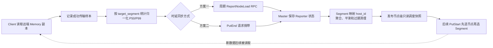
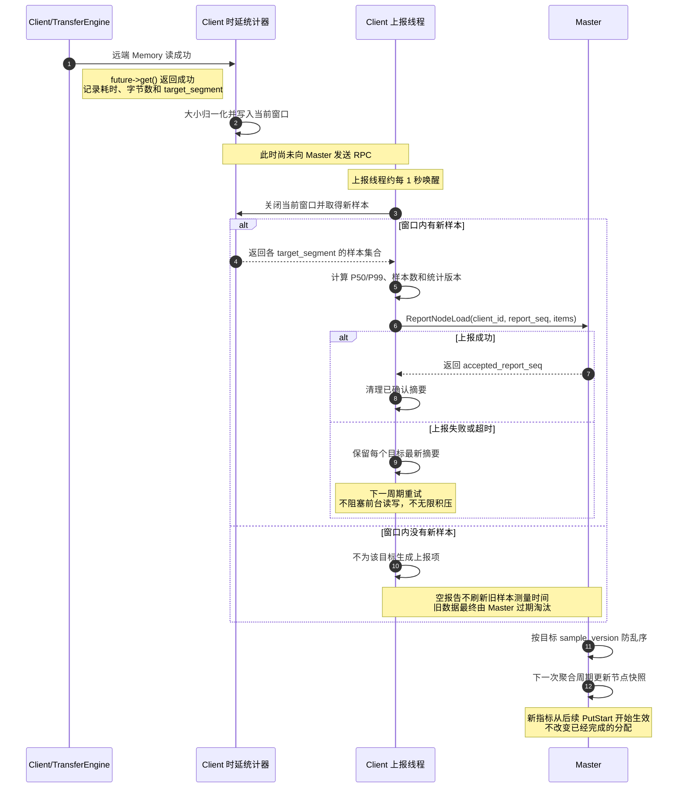
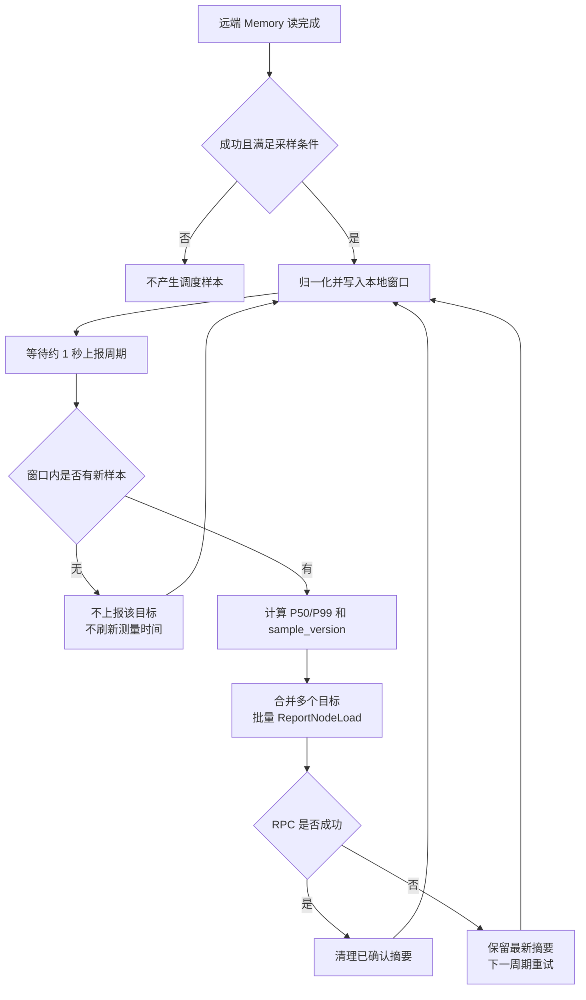
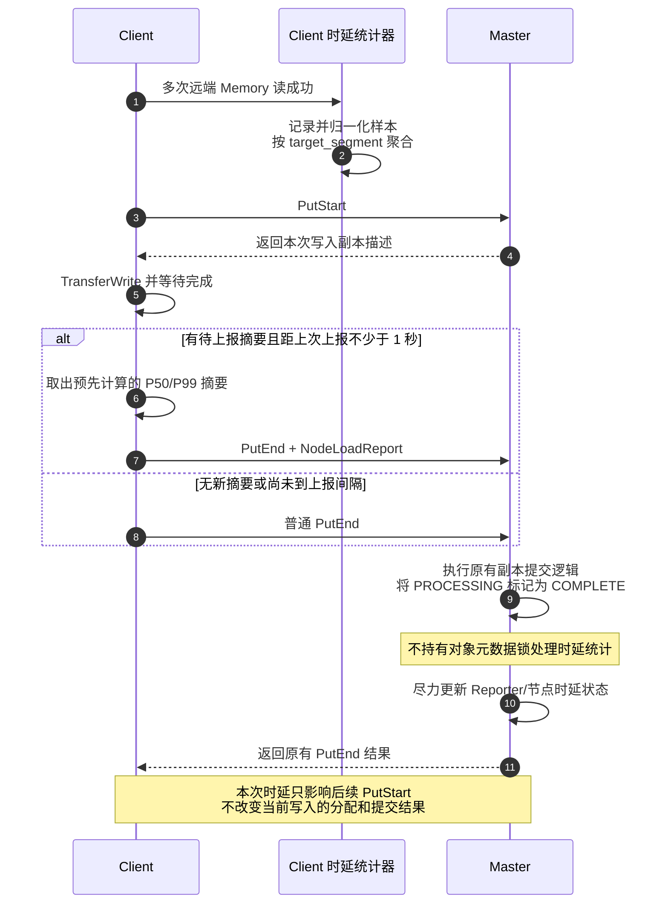
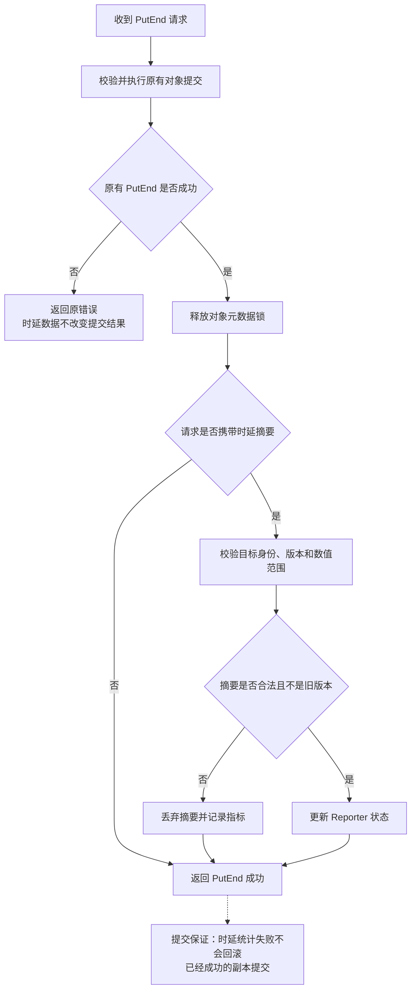
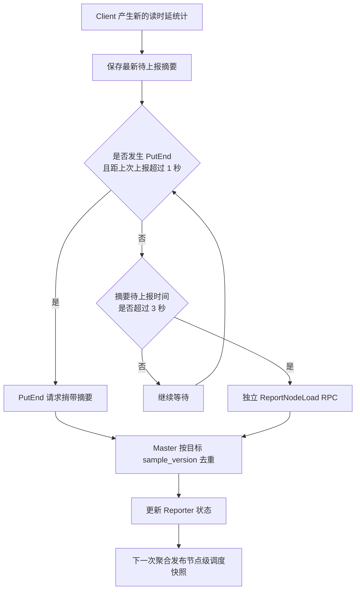
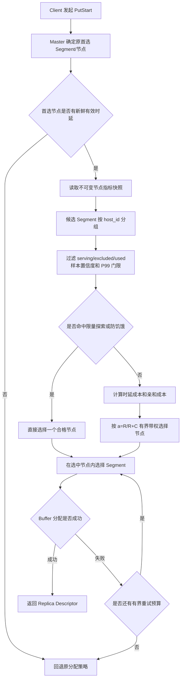

# Mooncake 节点级调度：Client 时延同步 Master 的两种方案

> 本文是方案设计，不代表相关代码已经实现。参考输入为“读负载反馈驱动的数据放置调度方案”，Mooncake 源码核对基线为 `468b35a`，整理日期：2026-11-10。图使用 Mermaid，公式中 MiB = 1024² 字节。

## 1. 背景与设计目标

参考方案通过读数据回写耗时调整后续写入的数据放置，但原实现依赖 Client 侧选点、Publish 响应反馈和 UB 端口健康状态。Mooncake Store 的写入副本分配由 Master 完成，而实际传输发生在 Client 和 Transfer Engine 中，因此需要将 Client 观测到的时延同步给 Master。

本文比较两种同步方案：

1. **周期独立上报**：Client 约每 1 秒通过新增 `ReportNodeLoad` RPC 批量上报。
2. **PutEnd 捎带上报**：Client 在既有写入提交 RPC 中附带待上报摘要。

最后给出兼顾写入活跃和纯读场景的混合建议。

### 1.1 本方案保留与移除的内容

保留参考算法中的：

- 成功读传输样本和大小归一化；
- 有界采样窗口与 P50/P99；
- 偏重尾延迟的成本；
- 首选节点亲和惩罚；
- 有界带权选择、防饥饿和原策略回退。

完全移除：

- 根据故障端口决定是否进入调度；
- 健康端口比例及其权重因子；
- 健康端口数准入、全端口故障和端口恢复分支；
- 端口状态与时延的叠加惩罚。

调度只依赖读时延、节点亲和性，以及 Master 已有的 serving、excluded、used、容量和副本分配约束。

### 1.2 作用范围

本方案只调整**后续新增 Memory 副本的放置**：

- 不迁移已经存在的对象；
- 不改变 `PutEnd` 将副本标记为 `COMPLETE` 的提交语义；
- 第一阶段不改变现有 Client 读副本选择；
- NoF、Disk、DFS 和必须严格指定 Segment 的请求维持原逻辑。

整体闭环为：



## 2. 两种方案的共同基础

### 2.1 Client 采样边界

普通读写最终会在 [`TransferData()`](../mooncake-store/src/client_service.cpp#L4831-L4862) 中提交任务并等待 `future->get()`。建议在该统一位置采集传输耗时，并只保留满足以下条件的样本：

- 操作为 `TransferRequest::READ`；
- 目标是远端 Memory 副本；
- `future->get()` 成功；
- 数据量至少 256 KiB；
- 耗时和目标身份有效。

本地热缓存、本地内存、Disk、DFS 和失败传输不进入该指标。批量 scatter 如果包含多个目标，不能把总耗时重复记到每个节点；第一阶段可不纳入，后续按目标拆分完成时间后再接入。

设实际读取大小为 $D$，传输耗时为 $t$，基准大小 $D_0=4\ \mathrm{MiB}$，归一化时延为：

$$
L=\max\left(1,\left\lfloor\frac{tD_0}{D}\right\rfloor\right)
$$

该指标表示“读取 4 MiB 的等效耗时”，包含 TE 提交、排队和等待远端传输完成的时间，不是完整业务 Get 时延，也不是网卡剩余带宽。

### 2.2 目标 Segment 和节点身份

当前 [`MemoryDescriptor`](../mooncake-store/include/replica.h#L343-L346) 只有 Buffer 和 locality，没有可靠的 Segment/节点身份。`transport_endpoint_` 可能是 hostname，也可能是 P2P `ip:port`，不应通过解析 endpoint 猜测节点。

建议在 `MemoryDescriptor` 尾部增加兼容字段 `target_segment`，由 Master 在 [`Replica::get_descriptor()`](../mooncake-store/include/replica.h#L934-L950) 中通过 `AllocatedBuffer::getSegmentName()` 填充：

```cpp
struct_pack::compatible<std::string, 2> target_segment;
```

Client 按 `target_segment` 统计；Master 再根据 [`Segment`](../mooncake-store/include/types.h#L505-L519) 的挂载信息映射为 `host_id`。`host_id` 为空时退化为 `Segment.name`。旧 Master 不返回该字段时，新 Client 跳过对应样本。

### 2.3 上报数据模型

两种通道使用同一份摘要，避免产生不同的统计语义：

| 字段 | 含义 |
| --- | --- |
| `report_seq` | Client 单调递增的报告批次号，用于诊断和批次去重 |
| `target_segment` | 被读取副本所属 Segment |
| `sample_version` | 每个 Client/目标单调递增的统计版本，用于防止旧报告覆盖新报告 |
| `p50_us` / `p99_us` | 归一化读时延分位数，建议使用 64 位整数 |
| `sample_count` | 当前统计窗口的有效样本数 |
| `window_end_age_ms` | 发送时统计窗口结束点距当前的毫秒数 |

Master 按 `(client_id, target_segment)` 检查 `sample_version`，而不是仅靠整个 RPC 的批次号拒绝旧报文。这样即使周期上报和 PutEnd 上报并发、携带的目标集合不同，也不会误丢弃较新的其他目标统计。

Master 使用本地单调接收时间和 `window_end_age_ms` 判断测量新鲜度，不依赖 Client 与 Master 的墙钟同步。空报告不刷新测量时间。

### 2.4 Master 聚合和节点调度

Master 保存两层状态：

1. `(client_id, target_node)` 的最新 Reporter 记录；
2. 每个节点的只读调度快照。

RPC 处理只更新第一层。Master 约每秒聚合一次：

- 淘汰过期 Reporter；
- 将同一 `host_id` 下多个 Segment 的记录合并；
- 对不同 Client 的 P50/P99 做带权重上限的加权中位数聚合；
- 对聚合结果做 EWMA 平滑；
- 原子发布新快照。

加权中位数和 EWMA 的结果是调度指标，不应解释为严格的全集群分位数。建议 3 个周期无更新标记为不新鲜，10 秒无新测量数据退出正常带权候选；这些数值是设计默认值，不是当前代码已有配置。

设节点 $i$ 的聚合指标为 $P_{50,i}$、$P_{99,i}$，首选节点为 $p$，非亲和惩罚为 $\delta=200\,\mu s$：

$$
C_i=\frac{P_{50,i}+3P_{99,i}}{4}+
\begin{cases}
0,&i=p\\
\delta,&i\neq p
\end{cases}
$$

节点吸引力为：

$$
\boxed{a_i=\frac{R}{R+C_i}}
$$

其中 $R=1000\,\mu s$。公式中没有任何端口数量或健康因子。

## 3. 方案一：周期独立上报

### 3.1 上报时机

方案一采用“**读完成只记录样本，约每 1 秒批量上报**”：

- 读成功时不立即发送 RPC；
- 上报线程约每 1 秒关闭当前统计窗口；
- 只有窗口出现新样本才生成该目标的上报项；
- 不再要求采满配额才刷新，低负载有新样本也可上报；
- 样本数不足时仍可上报，由 Master 标记低置信度并限制其进入正常候选；
- 没有新样本时不上报该目标，也不延长旧统计寿命；
- RPC 失败时保留每个目标的最新摘要，下一周期重试，不无限积压。

挂载 Segment 的 Client 可以在现有存储心跳周期内调用独立的 `ReportNodeLoad` RPC。现有 Ping 约每秒执行，见 [`StorageHeartbeatThreadMain()`](../mooncake-store/src/client_service.cpp#L5412-L5418)，但存储控制面只在特定路径启动，见 [`EnsureStorageControlPlaneStarted()`](../mooncake-store/src/client_service.cpp#L922-L931)。因此纯读取 Client 需要在功能开启时启动独立上报循环。

### 3.2 总体时序



### 3.3 上报决策图



### 3.4 优点与问题

| 类别 | 说明 |
| --- | --- |
| 优点 | 上报周期与是否发生写入解耦，纯读 Client 也能持续反馈 |
| 优点 | 不增加 PutEnd 请求体和前台提交序列化开销 |
| 优点 | 失败重试只涉及性能提示，不与副本提交结果耦合 |
| 问题 | 新增 RPC 和上报生命周期管理，写入活跃时也可能产生额外控制流量 |
| 问题 | 需要限制单 RPC 目标数、单 Client 目标数和重试缓存，防止状态膨胀 |
| 问题 | 周期是软实时间隔；RPC 失败、线程繁忙时不存在严格上报时延上界 |
| 问题 | 如果只复用存储心跳线程，会漏掉未挂载 Segment 的纯读取 Client |

正常样本从产生到影响调度，通常需要“等待上报周期 + RPC + 等待 Master 聚合”，约为 0～2 秒加 RPC 和线程调度耗时，但不是硬实时保证。

## 4. 方案二：PutEnd 捎带上报

### 4.1 上报时机

Client 当前在传输结束后调用 [`PutEnd`](../mooncake-store/src/client_service.cpp#L2183-L2193)，Master 在 [`PutEnd`](../mooncake-store/src/master_service.cpp#L5325-L5337) 中执行副本提交。可以利用这一既有 RPC 携带统计摘要。

不是每次 PutEnd 都附加上报，只有同时满足以下条件才捎带：

1. 存在尚未上报的新读时延摘要；
2. 距上次上报已达到约 1 秒；
3. 当前写入本来就准备调用 PutEnd。

P50/P99 必须提前计算，PutEnd 热路径只负责复制有界摘要，不能扫描样本、排序或计算分位数。批量写入应在整个 `BatchPutEnd` 中只携带一次，避免逐键重复。

### 4.2 PutEnd 时序



### 4.3 Master 处理顺序



### 4.4 优点与问题

| 类别 | 说明 |
| --- | --- |
| 优点 | 复用既有 Client 到 Master RPC，写入活跃时不需要额外周期请求 |
| 优点 | Client 已在写入 finalize 阶段接触 Master，接入路径直接 |
| 优点 | 通过约 1 秒最小间隔和批量摘要，可以控制高频 PutEnd 的附加开销 |
| 问题 | 纯读场景没有 PutEnd，统计无法同步 |
| 问题 | 低写入场景的上报延迟取决于下一次 PutEnd，没有固定上界 |
| 问题 | 走 PutRevoke 或不调用 PutEnd 的路径无法捎带 |
| 问题 | 增大 PutEnd 请求体和前台序列化开销，必须预先计算摘要并限制条目数 |
| 问题 | PutEnd 失败时不能只为了性能指标而盲目重试提交 RPC |
| 问题 | 修改既有 RPC 请求需要处理新旧 Client/Master 的滚动兼容 |

协议上可以增加带 `struct_pack::compatible` 字段的请求结构，或者新增 `PutEndV2`。如果直接扩展现有 `ObjectMeta`，必须验证新旧版本的序列化兼容性。Master 必须先完成原有提交，再在元数据锁外处理统计；非法时延数据不能导致 PutEnd 失败。

PutEnd 捎带的内容仍然是此前已经统计好的**读时延摘要**，不是 PutEnd RPC 自身时延。如果改为上报写传输时延，则指标含义和优化目标随之改变，不能与读时延样本混用。

## 5. 两种方案对比

| 维度 | 周期独立上报 | PutEnd 捎带上报 |
| --- | --- | --- |
| 主要触发条件 | 约 1 秒周期到达且有新样本 | 有 PutEnd、有待上报摘要且达到最小间隔 |
| 纯读 Client | 支持 | 不支持，长期无反馈 |
| 低写入场景 | 仍有周期反馈 | 反馈可能无限延迟 |
| 额外 RPC | 需要 | 写入活跃时不需要 |
| PutEnd 热路径开销 | 无新增请求字段 | 增加有界序列化和传输开销 |
| 失败重试 | 下一周期重试摘要 | 不能只为指标重试 PutEnd |
| 协议影响 | 新增独立 RPC，不影响既有提交协议 | 扩展既有请求或新增 V2 |
| Master 处理耦合 | 与副本提交完全解耦 | 必须先提交、后处理统计，统计失败不影响提交 |
| 适用场景 | 纯读、读写混合、要求持续反馈 | 写入持续活跃且允许统计在停写后老化 |

**只使用 PutEnd 上报，会重新引入参考方案中“只有成功 Publish 才反馈”的问题，只是反馈方向从响应变成了请求。**

## 6. 推荐方案：PutEnd 主通道与周期兜底

如果允许纯读或停写期间统计老化，单独使用 PutEnd 是较简单的实现。如果要求读反馈持续有效，推荐混合方案：

- 写入活跃时，优先随 PutEnd 捎带，减少额外 RPC；
- 摘要等待超过 3 秒仍未发送时，通过独立 `ReportNodeLoad` 补报；
- 纯读 Client 完全由周期通道上报；
- 两个通道使用相同的 `(client_id, target_segment, sample_version)` 防乱序语义；
- 没有新样本时不上报，也不通过空 PutEnd 或空周期报告续期；
- Master 重启后统计数据丢失，冷启动回退原分配策略，不写 WAL/ETCD。



### 6.1 不同场景下的实际上报行为

| 场景 | Client 行为 | Master 行为 |
| --- | --- | --- |
| 远端 Memory 读成功 | 记录样本，等待 PutEnd 或周期通道 | 等待有效报告 |
| 读失败、本地缓存命中、Disk/DFS 读取 | 不产生该类样本 | 无更新 |
| 写入活跃且摘要达到最小间隔 | 随下一次 PutEnd 上报 | 提交成功后处理统计 |
| 摘要等待超过兜底阈值 | 独立 ReportNodeLoad 补报 | 按 sample_version 接收新数据 |
| 持续纯读 | 周期通道持续上报 | 不依赖 PutEnd 获得反馈 |
| 周期内没有新读取 | 不上报该目标 | 保留至过期，随后退出正常候选 |
| 上报 RPC 失败 | 保留最新摘要，按通道规则重试 | 旧数据保留至过期 |
| 同时读取多个目标 | 合并为有界批量摘要 | 分目标更新 |
| 功能关闭或目标身份未知 | 不上报 | 使用原分配策略 |

## 7. Master 后续调度流程

Master 的写入分配入口位于 [`AllocateReplicas()`](../mooncake-store/src/master_service.cpp#L4802-L4865)。建议新增独立的 `READ_LATENCY_AWARE` 策略，不改变现有 RANDOM、FREE_RATIO_FIRST 等策略。

不能只向当前 Ranked 策略增加一个时延评分，因为现有实现会在评分前优先分配 `preferred_segments`，见 [`AllocateRanked()`](../mooncake-store/include/allocation_strategy.h#L501-L537)。新策略需要把首选节点转换为软亲和成本，同时继续遵守原有约束。



必须先按节点分组、再选 Segment，否则同一节点 Segment 越多，其被带权抽中的总概率越高。无统计节点不参与正常带权选择，但允许通过限量探索获得写入，避免“没有统计 → 永远不被写入 → 永远没有统计”的死锁。

## 8. 可观测性与验收重点

建议增加以下指标：

- Client：有效样本数、窗口刷新次数、待上报摘要年龄、两种通道的上报成功/失败次数；
- Master：新鲜 Reporter 数、节点 P50/P99、低置信度节点数、过期记录数、旧版本报告拒绝数；
- 调度：带权选择、防饥饿、探索、原策略回退和 Segment 分配失败次数；
- PutEnd：附带摘要的请求数、摘要条目数、序列化耗时和非法摘要数。

重点验证：

1. 纯读 Client 在混合方案下仍能持续上报；
2. 低样本窗口能够刷新，但不会被当作高置信度 P99；
3. 没有新样本时旧统计能够过期，不被空报告续期；
4. PutEnd 和周期报告乱序到达时，旧 `sample_version` 不覆盖新值；
5. PutEnd 中统计非法或处理失败不影响副本提交；
6. Master 重启、Client 重启和 Segment unmount 后能够回退或清理状态；
7. 新节点可以通过限量探索形成后续统计；
8. 新旧 Client/Master 混合部署时协议行为符合预期；
9. 批量 PutEnd 只上报一次，批量 scatter 不错误归因传输耗时；
10. 对比开关前后的业务读 P50/P99、写提交时延、Master CPU 和 RPC 流量。

## 9. 结论

- **周期独立上报**解决纯读和低写入场景的反馈连续性，但需要新增 RPC 和生命周期管理。
- **PutEnd 捎带上报**复用现有链路，适合写入持续活跃的场景，但单独使用不能保证反馈时效。
- 对需要持续读负载反馈的 Mooncake 节点级调度，推荐采用**PutEnd 主通道 + 超时周期补报**，并统一统计版本、样本年龄、过期和回退语义。
