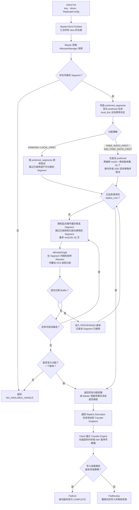

# Mooncake Store 数据写入的节点选择机制

## 1. 分析范围

本文基于当前仓库的 C++ `mooncake-store` 实现，分析 `Client.Put` 到 `MasterService` 完成副本分配的主路径，不包含独立的 `mooncake-store-rs` 实现。

核心结论：Mooncake Store 不是由 Client 按 Key 做一致性哈希来选择存储节点，而是由 Master 在 `PutStart` 阶段，从当前可服务的 Segment 中分配存储空间，再将目标地址返回给 Client。Client 随后通过 Transfer Engine 写入数据。

## 2. 整体写入流程

1. Client 调用 `Put`，汇总所有 Slice 的长度，并携带 `ReplicateConfig`。
2. Client 通过 `MasterClient.PutStart` 向 Master 请求分配副本。
3. Master 获取 AllocatorManager 快照，构造首选 Segment 列表。
4. Master 根据配置的 AllocationStrategy 选择 Segment，并在 Segment 内分配 Buffer。
5. Master 保存对象元数据，返回 `Replica::Descriptor`，其中包含 Buffer 地址和 Transfer Endpoint。
6. Client 根据 Descriptor 通过 Transfer Engine 写入内存或 NoF 副本。
7. 写入结果满足副本完成策略时调用 `PutEnd`，将成功副本标记为 `COMPLETE`；否则调用 `PutRevoke`。

相关代码：

- [Client::Put](../mooncake-store/src/client_service.cpp#L2053-L2209)
- [MasterClient::PutStart](../mooncake-store/src/master_client.cpp#L780-L796)
- [MasterService::AllocateReplicas](../mooncake-store/src/master_service.cpp#L4802-L4994)

## 3. Segment、Allocator 与节点的关系

Mooncake Store 的实际分配单位是 **Segment**，通常对应存储节点注册的一段内存：

- 一个 Segment 名称下可以注册多个 Allocator。
- Master 先选择 Segment，再从该 Segment 内选择 Allocator。
- 只有存活且可分配的 Segment 才进入候选集合。
- Allocator 分配前后都会检查 Segment 生命周期和 Client 存活状态，避免向已下线或正在卸载的目标分配数据。
- 同一对象的多个副本会放在不同 Segment 名称上，但这不保证它们一定位于不同物理主机、机架或可用区。

存活与分配检查见 [segment_allocator_registration.cpp](../mooncake-store/src/segment_allocator_registration.cpp#L13-L44)。

## 4. 节点选择的关键配置

`ReplicateConfig` 中与放置相关的主要字段如下：

| 字段 | 作用 |
| --- | --- |
| `replica_num` | 请求的内存副本数，默认为 1。 |
| `preferred_segments` | 首选 Segment 列表，按顺序尝试。 |
| `preferred_segment` | 单个首选 Segment 的兼容字段；非空时优先于 `preferred_segments`。 |
| `prefer_alloc_in_same_node` | 请求优先在写入方所在主机分配内存副本。 |
| `host_id` | 写入方主机标识，用于 Local First 匹配。 |
| `preferred_hca_names` | Segment 内部 Allocator 的 HCA 亲和提示。 |
| `preferred_nof_segments` | NoF 副本的首选 Segment。 |

配置定义见 [replica.h](../mooncake-store/include/replica.h#L108-L139)。

对于普通 `random`、`free_ratio_first` 和 `local_first` 策略，preferred 是**软偏好**：目标不存在、不可用或空间不足时，会继续尝试其他 Segment，并非强制绑定。CXL 策略是例外。

## 5. Master 如何构造优先 Segment 列表

Master 按以下顺序构造 `preferred_segments`：

1. 添加用户显式指定的 `preferred_segment` 或 `preferred_segments`，同时去重并保持原有顺序。
2. 如果满足以下条件，追加按主机顺序排列的 Segment：
   - Master 配置了 `allocation_strategy=local_first`，或者请求设置了 `prefer_alloc_in_same_node=true`；
   - `replica_num == 1`。

因此，显式 preferred 的优先级高于 Local First。显式目标分配失败后，才会回退到 Local First 生成的主机顺序。

实现见 [MasterService::AllocateReplicas](../mooncake-store/src/master_service.cpp#L4817-L4865) 和 [MasterService::PrepareWriteStart](../mooncake-store/src/master_service.cpp#L5146-L5153)。

## 6. 可选分配策略

Master 默认使用 `random`，可通过 `--allocation_strategy` 或配置文件修改。配置入口见 [master.cpp](../mooncake-store/src/master.cpp#L406-L411)，策略工厂见 [allocation_strategy.h](../mooncake-store/include/allocation_strategy.h#L731-L747)。

| 策略 | 节点选择方式 | 适用目标 |
| --- | --- | --- |
| `random` | 先尝试 preferred；未满足副本数时，从随机位置开始循环遍历可服务 Segment。 | 默认策略，分配开销较低。 |
| `free_ratio_first` | 先尝试 preferred；再随机抽样候选 Segment，按内存空闲率降序尝试。 | 更均衡的内存利用率。 |
| `ssd_free_ratio_first` | 与上一种类似，但评分依据是 Segment 所属 Client 的本地 SSD 空闲率。 | SSD 感知的放置与卸载场景。 |
| `local_first` | 底层仍使用随机分配器，但 Master 预先将本机及远端 Segment 按主机顺序加入 preferred。 | 优先将单内存副本放在写入主机。 |
| `cxl` | 只使用第一个 preferred Segment，在其中寻找可服务 Allocator。 | CXL 内存分配。 |

CXL 失败时不走通用随机回退；普通策略则会在 preferred 失败后继续寻找其他候选。

## 7. 默认 Random 策略

当前实现见 [RandomAllocationStrategy::Allocate](../mooncake-store/include/allocation_strategy.h#L311-L407)。

### 7.1 候选检查

- 没有可服务 Segment：返回 `NO_AVAILABLE_HANDLE`。
- 请求大小为 0 或副本数为 0：返回 `INVALID_PARAMS`。
- 只有一个可服务 Segment：直接尝试该 Segment。

### 7.2 多 Segment 分配顺序

1. 按顺序尝试 preferred Segment。
2. 随机生成候选数组的起始下标。
3. 从该位置循环遍历可服务 Segment。
4. 跳过已排除或已经成功使用的 Segment。
5. 最多尝试 `min(100, Segment 数量)` 次。
6. 达到 `replica_num` 后立即停止。

策略层只有在完全没有分配到副本时才返回失败；如果只分配到部分副本，可以返回实际分配结果，是否接受由 Master 的副本模式检查决定。

## 8. Free Ratio First 策略

`free_ratio_first` 使用“随机抽样 + 评分排序”，不是每次扫描整个集群：

```text
抽样数量 = min(6 × 剩余待分配副本数, 可服务 Segment 总数)
```

Segment 的内存空闲率计算方式为：

```text
内存空闲率 = Segment 内所有 serving Allocator 的空闲容量之和
             ------------------------------------------------
             Segment 内所有 serving Allocator 的总容量之和
```

具体过程：

1. 先尝试 preferred Segment。
2. 随机抽取候选 Segment，计算空闲率并降序排序。
3. 依次尝试高分候选。
4. 如果仍未满足副本数，再退回随机遍历。
5. 成功使用的 Segment 不会承载同一对象的另一个副本。

`ssd_free_ratio_first` 复用相同的抽样和回退框架，只将评分替换为 Segment 所属 Client 的 SSD 空闲率。

实现见 [RankedAllocationStrategy](../mooncake-store/include/allocation_strategy.h#L479-L589)、[FreeRatioFirstAllocationStrategy](../mooncake-store/include/allocation_strategy.h#L591-L635) 和 [allocation_strategy.cpp](../mooncake-store/src/allocation_strategy.cpp#L18-L67)。

## 9. Local First 的主机排序

Local First 只针对 `replica_num == 1` 的内存副本自动生效：

- 写入主机存在可服务 Segment：从写入主机开始。
- 写入主机不存在：从 Host ID 字典序中下一个更大的主机开始，到末尾后回绕。
- 同一主机内，Segment 按名称排序，再使用 `hash(key)` 旋转起始位置。
- 本机 Segment 满或不可用后，按上述主机顺序尝试远端主机。
- 所有主机顺序候选都失败后，仍可进入通用随机回退。

因此，Key Hash 只影响 Local First 在同一主机内的 Segment 起始位置，不决定全局存储节点。

实现见 [BuildHostOrderedSegments](../mooncake-store/src/segment.cpp#L47-L90)。

批量写入且设置 `prefer_alloc_in_same_node` 时，第一个 Key 成功分配后，其内存 Endpoint 会作为后续 Key 的 `preferred_segment`，使一批数据尽量落到同一目标；该偏好失败时仍可回退。见 [WrappedMasterService::BatchPutStart](../mooncake-store/src/rpc_service.cpp#L575-L597)。

## 10. Segment 内部的 Allocator 选择

选中 Segment 后，`allocateSingle` 继续选择具体 Allocator：

- 只有一个 Allocator：直接分配。
- 有多个 Allocator：随机选择起点，循环尝试，直到分配成功。
- 如果存在 HCA 亲和提示，则按以下层级依次尝试：
  1. HCA 完全匹配；
  2. Segment 拓扑信息未知；
  3. 已知拓扑但 HCA 不匹配。

HCA 亲和只影响已选 Segment 内部的 Allocator 选择，不是全局节点选择算法。

相关实现：

- [RandomAllocationStrategy::allocateSingle](../mooncake-store/include/allocation_strategy.h#L431-L468)
- [HcaAffinityTier](../mooncake-store/include/types.h#L481-L495)

## 11. Mermaid 流程图

下图展示通用内存分配路径；CXL 使用单独的限制性分配逻辑。



## 12. 副本不足与失败处理

需要区分分配阶段和写入阶段。

### 12.1 分配阶段

- **纯内存副本**，即 `nof_replica_num == 0 && dfs_replica_num == 0`：采用 best-effort。请求多个副本但资源不足时，只要至少一个副本分配成功，`PutStart` 就可以继续，同时记录部分分配日志和指标。
- **包含 NoF 或 DFS 的多数配置**：通常要求请求的各类副本数量完全满足，否则返回 `NO_AVAILABLE_HANDLE`。
- **1 内存 + 1 NoF 的灵活双副本模式**：任意一种副本分配成功即可继续。

### 12.2 写入阶段

进入传输阶段后，`RELIABLE_MULTI_REPLICA` 要求所有实际分配的副本都写入成功，否则撤销对应写入。这里的可靠性约束针对实际分配的副本，不会把分配阶段已经发生的副本数降级重新补足。

判定逻辑见 [HasExpectedReplicaAllocation](../mooncake-store/src/master_service.cpp#L80-L109)。

## 13. 总结

Mooncake Store 的节点选择可以概括为：

```text
筛选可服务 Segment
    → 合并显式 preferred 与 Local First 偏好
    → 按 Random、Free Ratio、SSD Free Ratio 或 CXL 策略选择 Segment
    → 在 Segment 内选择 Allocator，可叠加 HCA 亲和
    → 返回目标 Descriptor
    → Client 执行实际数据传输
    → PutEnd 或 PutRevoke
```

默认路径追求较低的分配开销；空闲率策略更关注资源均衡；Local First 更关注写入本地性；多副本约束以 Segment 名称去重，而不是自动提供物理主机级或可用区级反亲和。
