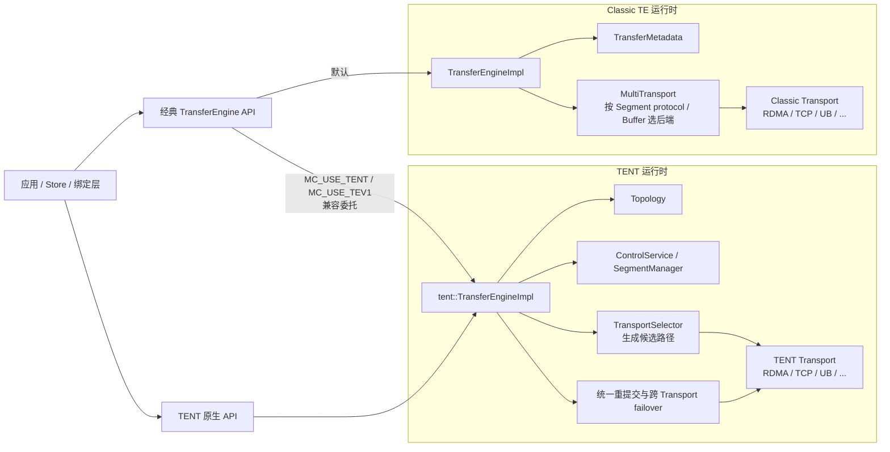
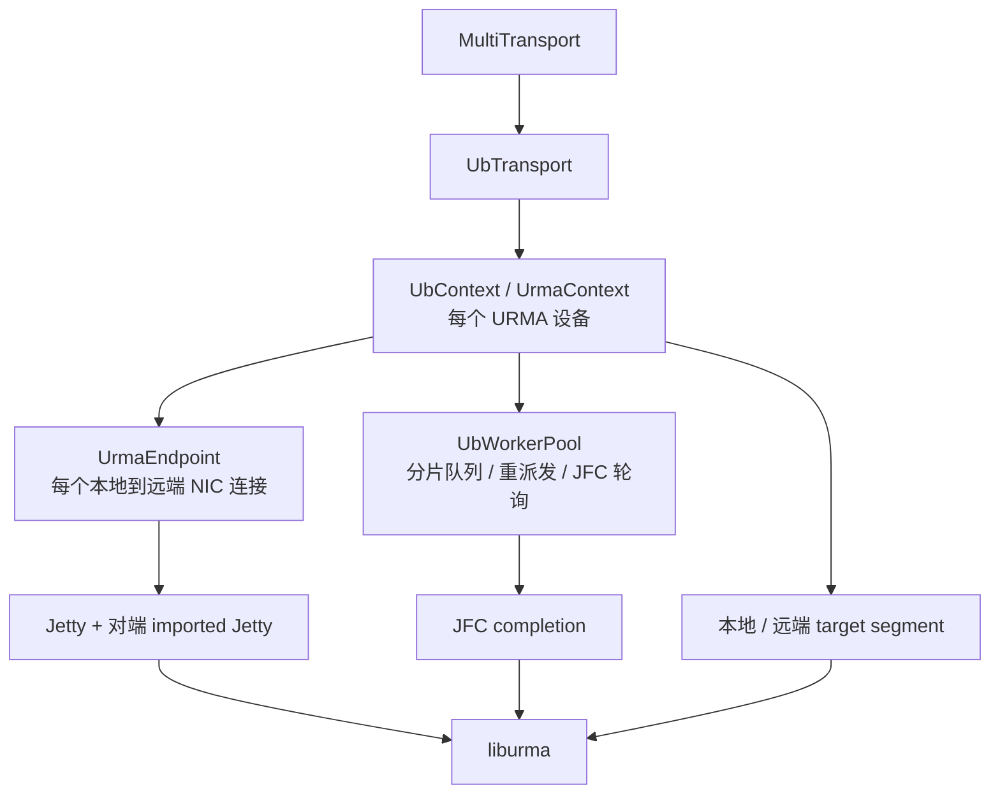
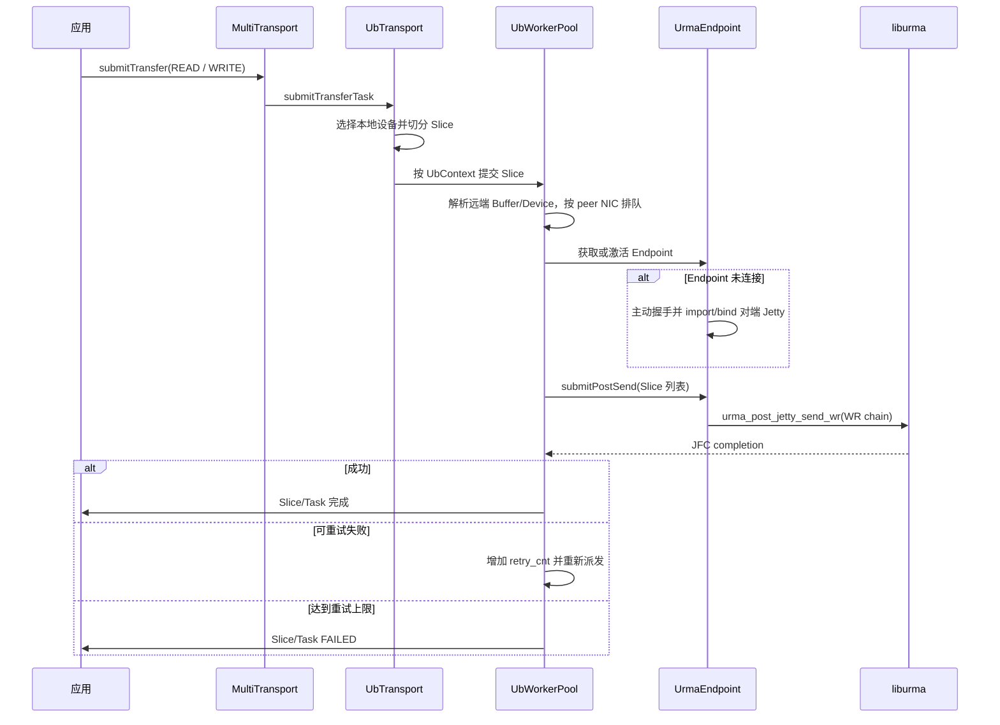
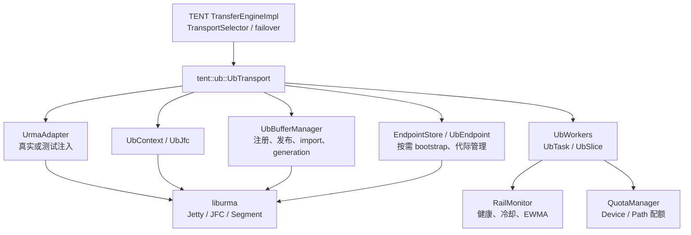

# TE 与 TENT 架构对比：重点分析 UB

## 1. 分析范围与结论摘要

本文基于 `tent/perf` 分支、分析基线提交 `e2c1abe` 的源码，比较经典 Transfer Engine（下文简称 **Classic TE** 或 **TE**）与 Transfer Engine NEXT（**TENT**）的总体架构，重点拆解两者的 Kunpeng UB（Unified Bus）实现。

本文是**静态代码分析**，不包含真实 Kunpeng/URMA 环境上的功能、故障注入或性能测试；文中“更快”“更低开销”等不作为已验证结论。性能优劣必须结合设备数量、Slice 大小、连接冷热状态和故障场景实测。

核心结论如下：

1. **TENT 不是 Classic `MultiTransport` 中新增的一个 UB 插件，而是与 Classic 并行的另一套运行时。** 它可以承接经典 `TransferEngine` API，但内部使用自己的 Topology、ControlService、TransportSelector、任务状态机与容错机制。
2. **TENT UB 也是独立实现，不调用 Classic `UbTransport` / `UbWorkerPool`。** 两者复用的是 URMA 编程模型、构建依赖和相似的原语（Context、Jetty、JFC、Segment），不是同一条 C++ 数据路径。TENT 源码对此有明确约束，见 [`ub_transport.h`](../mooncake-transfer-engine/tent/include/tent/transport/ub/ub_transport.h#L27-L30)。
3. **二者的 UB 核心 I/O 语义相同**：把请求切成 Slice，通过 URMA Jetty 提交单边 `READ` / `WRITE`，由 JFC 轮询完成；SGE 直接引用调用者 buffer 和已注册 Segment，UB 插件内部没有额外 staging copy。
4. **主要差异不在 URMA WR 本身，而在 WR 之前的决策和 WR 之后的管理。** Classic 以设备选择、Endpoint 队列和有界重试为主；TENT 增加多 Rail 评分、EWMA 遥测、分层 Quota、连接按需建立、Buffer generation、完成 token、超时 DMA fence，以及运行时跨 Transport failover。
5. **TENT 的能力更完整，但启用和验证成本也更高。** UB 默认关闭，需要 `USE_TENT=ON`、`USE_UB=ON`、显式配置和真实 `liburma`。真实 provider 错误、bonding 故障切换和冷启动多 Rail bootstrap 仍需硬件验证，不能由 Fake Adapter 测试替代。

## 2. 术语与代码边界

| 名称 | 本文含义 | 需要避免的混淆 |
| --- | --- | --- |
| Classic TE / TE | `mooncake::TransferEngine` 下的经典 `TransferEngineImpl → MultiTransport → Transport` 路径 | 不是仅指某一个 RDMA 后端 |
| TENT | `mooncake::tent` 命名空间中的 Transfer Engine NEXT 运行时 | 不是 Classic `MultiTransport` 的普通插件 |
| UB | Unified Bus，本文聚焦 Kunpeng UB Transport | 不等于 UBShmem |
| URMA | Unified Remote Memory Access，提供 Context、Jetty、JFC、Segment 和单边读写 API | 是 UB 的用户态编程接口，不是 Mooncake Transport 本身 |
| OBMM | Ownership Based Memory Management，另一种 UB 软件实现方向 | Classic 虽声明 `OBMM_ENDPOINT`，当前实现直接返回“不支持”，见 [`ub_transport.cpp`](../mooncake-transfer-engine/src/transport/kunpeng_transport/ub_transport.cpp#L499-L510) |
| Rail | 一条本地 UB 设备到远端 UB 设备的物理路径 | TENT 的 Rail 健康状态不等于某一代 Endpoint 对象 |
| Slice | 一个 Request/Task 被切分后的独立提交与完成单元 | 不等于 URMA WR；组链时多个 Slice 可对应同一次 post 中的多个 WR |

Classic UB 的头文件注释仍写着支持 URMA 和 OBMM 两类 Endpoint，并保留了枚举，见 [`ub_transport.h`](../mooncake-transfer-engine/include/transport/kunpeng_transport/ub_transport.h#L30-L47)；但实现只构造 `UrmaContext`，OBMM 分支未实现。因此，本文对两套实现的比较均以 **URMA 数据路径**为准。

## 3. TE 与 TENT 总体架构

### 3.1 两套运行时的位置



Classic 初始化装配 `TransferMetadata` 和 `MultiTransport`，见 [`transfer_engine_impl.cpp`](../mooncake-transfer-engine/src/transfer_engine_impl.cpp#L223-L232)。提交时，`MultiTransport` 先为每个 Request 选择 Transport，再按 Transport 分组调用 `submitTransferTask()`，见 [`multi_transport.cpp`](../mooncake-transfer-engine/src/multi_transport.cpp#L249-L327)。对混合协议 Segment，选择逻辑还会按目标地址找到对应 Buffer，再依据协议优先级路由，见 [`multi_transport.cpp`](../mooncake-transfer-engine/src/multi_transport.cpp#L778-L846)。

TENT 的 `construct()` 则依次建立 Topology、ControlService、本地 Segment、TransportSelector，随后加载并安装 Transport，见 [`transfer_engine_impl.cpp`](../mooncake-transfer-engine/tent/src/runtime/transfer_engine_impl.cpp#L372-L510)。因此，TENT 的“选择什么路径”和“某个 Transport 如何发 WR”是两个更明确的层次：

- 运行时负责候选 Transport 排序、任务状态、staging、重提交和 failover。
- UB Transport 负责 UB 内部设备/Rail 选择、URMA 资源、Endpoint 和 Slice 生命周期。

TENT 的总体设计文档也把动态 Transport 选择、细粒度遥测调度和运行时故障处理列为三个核心方向，见 [`overview.md`](../docs/source/design/tent/overview.md#L21-L59)。

### 3.2 经典 API 兼容层不等于复用 Classic 数据面

经典 `TransferEngine` 构造时检查 `MC_USE_TENT` 和 `MC_USE_TEV1`，见 [`transfer_engine.cpp`](../mooncake-transfer-engine/src/transfer_engine.cpp#L534-L541)。启用后：

- `init()` 创建 `mooncake::tent::TransferEngine`，见 [`transfer_engine.cpp`](../mooncake-transfer-engine/src/transfer_engine.cpp#L670-L707)。
- 请求被转换成 `tent::Request` 后提交给 TENT，而不是再进入 Classic `MultiTransport`。
- `installTransport()` 只返回兼容对象，是 no-op；不能用它把 Classic UB 安装进 TENT，见 [`transfer_engine.cpp`](../mooncake-transfer-engine/src/transfer_engine.cpp#L726-L742)。

所以“使用相同经典 API”只表示外观兼容，不表示内部仍走 Classic UB。

## 4. Classic TE 的 UB 架构

### 4.1 组件与职责



| 组件 | 核心职责 | 关键源码 |
| --- | --- | --- |
| `UbTransport` | 安装 UB、注册内存、切分 Task/Slice、选择本地设备 | [`ub_transport.cpp`](../mooncake-transfer-engine/src/transport/kunpeng_transport/ub_transport.cpp#L37-L130) |
| `UbContext` / `UrmaContext` | 封装单个 URMA 设备、Context、JFC/JFR/JFCE、Endpoint 和 worker | [`urma_endpoint.cpp`](../mooncake-transfer-engine/src/transport/kunpeng_transport/urma/urma_endpoint.cpp#L521-L601) |
| `UbWorkerPool` | 解析远端 Buffer/Device，将 Slice 按对端 NIC 排队，提交、重派发和轮询 | [`ub_context.cpp`](../mooncake-transfer-engine/src/transport/kunpeng_transport/ub_context.cpp#L183-L299) |
| `UrmaEndpoint` | 管理 Jetty、握手、import/bind 对端 Jetty、构造并提交 WR | [`urma_endpoint.cpp`](../mooncake-transfer-engine/src/transport/kunpeng_transport/urma/urma_endpoint.cpp#L724-L789) |
| `Slice` | 保存本地/远端地址、Segment、Endpoint、重试次数和完成状态 | 由 [`ub_transport.cpp`](../mooncake-transfer-engine/src/transport/kunpeng_transport/ub_transport.cpp#L238-L260) 填充 |

### 4.2 初始化、发现与内存注册

`UbTransport::install()` 的顺序是：

1. 初始化 UB/URMA 资源；
2. 分配本地 Segment ID；
3. 启动握手服务；
4. 发布本地 Segment 描述。

对应实现见 [`ub_transport.cpp`](../mooncake-transfer-engine/src/transport/kunpeng_transport/ub_transport.cpp#L37-L80)。

注册本地内存时，它遍历所有 `UbContext`，将同一地址范围注册到各设备，并生成 `BufferDesc` 后写入 `TransferMetadata`，见 [`ub_transport.cpp`](../mooncake-transfer-engine/src/transport/kunpeng_transport/ub_transport.cpp#L83-L130)。后续提交依赖 Segment 中的 Buffer、设备和 transport segment 描述来定位本地与远端内存。

### 4.3 提交到完成的完整链路



关键步骤如下：

1. **本地设备选择与切片。** `UbTransport` 根据本地 Segment 和源地址选择设备，按全局 `slice_size` 切分，并用 `fragment_limit` 合并过小的尾片；每个 Slice 保存本地 target segment，见 [`ub_transport.cpp`](../mooncake-transfer-engine/src/transport/kunpeng_transport/ub_transport.cpp#L212-L332)。
2. **远端解析与排队。** `UbWorkerPool` 根据目标地址选择远端 Buffer/Device，取得远端 target segment，再按 `(target_id, device_id)` 分 shard、按 `peer_nic_path` 排队，见 [`ub_context.cpp`](../mooncake-transfer-engine/src/transport/kunpeng_transport/ub_context.cpp#L221-L298)。
3. **连接建立。** 未连接 Endpoint 通过经典握手 RPC 交换 NIC path 和 Jetty ID，再将对端 EID/Jetty import 并 bind，见 [`urma_endpoint.cpp`](../mooncake-transfer-engine/src/transport/kunpeng_transport/urma/urma_endpoint.cpp#L724-L789) 和 [`urma_endpoint.cpp`](../mooncake-transfer-engine/src/transport/kunpeng_transport/urma/urma_endpoint.cpp#L959-L1017)。
4. **直接构造单边 WR。** 本地和远端 SGE 分别指向 Slice 地址及 target segment；READ 时远端为 source、本地为 destination，WRITE 时相反，见 [`urma_endpoint.cpp`](../mooncake-transfer-engine/src/transport/kunpeng_transport/urma/urma_endpoint.cpp#L871-L948)。这里没有 UB 内部中转 buffer。
5. **完成与重试。** `UrmaContext::poll()` 调用 `urma_poll_jfc()`，成功直接 `markSuccess()`，失败返回 worker，见 [`urma_endpoint.cpp`](../mooncake-transfer-engine/src/transport/kunpeng_transport/urma/urma_endpoint.cpp#L521-L579)。worker 对失败 Slice 增加重试计数并重新派发，达到上限后才标记失败，见 [`ub_context.cpp`](../mooncake-transfer-engine/src/transport/kunpeng_transport/ub_context.cpp#L401-L463)。

### 4.4 Classic UB 的设计特征

- **结构直接**：Transport 自己完成设备选择、排队、连接和重试，策略主要留在 UB 实现内部。
- **以 Endpoint/对端 NIC 为组织中心**：连接缓存和 Slice 队列围绕 `peer_nic_path` 展开。
- **重试范围主要在 UB 内**：失败 Slice 可以重新解析远端描述并派发，但这条 Classic UB 路径没有 TENT 运行时那种统一的候选 Transport 重提交机制。
- **没有显式的 TENT 式 Rail 评分与代际协议**：当前实现未围绕物理 Rail 维护 EWMA、统一 Quota、Buffer generation 和完成 token 映射。
- **故障停用较粗粒度**：连续错误可使 Endpoint 或整个本地 Context inactive，相关逻辑见 [`ub_context.cpp`](../mooncake-transfer-engine/src/transport/kunpeng_transport/ub_context.cpp#L363-L383) 和 [`ub_context.cpp`](../mooncake-transfer-engine/src/transport/kunpeng_transport/ub_context.cpp#L423-L440)。

这些特征不意味着 Classic 必然性能较差。对于路径稳定、连接已热、无需跨后端恢复的场景，更少的策略层可能更容易分析和调优；但本文没有做性能对比实验。

## 5. TENT 的 UB 架构

### 5.1 组件与所有权



| 组件 | 核心职责 |
| --- | --- |
| `UrmaAdapter` | 抽象 URMA provider；生产环境使用真实实现，测试可注入 Fake Adapter |
| `UbContext` / `UbJfc` | 管理每个拓扑设备的 URMA Context、JFC、健康状态与完成轮询 |
| `UbBufferManager` | 本地注册、远端 import、权限和地址范围校验、generation 与句柄所有权 |
| `EndpointStore` / `UbEndpoint` | 缓存和退休 Endpoint，管理 Jetty 组、bootstrap、generation 和 quiesce |
| `UbWorkers` | Task/Slice 排队、Rail 选择、配额、提交、超时、完成与重试 |
| `RailMonitor` | 按物理 Rail 保存暂停状态、错误窗口、恢复信息和 EWMA 带宽/时延 |
| `QuotaManager` | 限制设备与路径的在途字节数和 WR 数，饱和时延后而不是盲目重试 |

### 5.2 安装、拓扑发现与能力协商

TENT 只有在编译启用 `USE_UB`、配置 `transports/ub/enable=true` 且 Topology 中存在 `NIC_UB` 时才创建 UB Transport，见 [`transport_loader.cpp`](../mooncake-transfer-engine/tent/src/runtime/transport_loader.cpp#L80-L105)。这是一套**编译条件加配置的装配器**，不是通用动态插件加载机制。

UB 安装过程包括：

1. 检查 adapter、配置与通知能力；
2. 初始化 URMA 并发现设备；
3. 结合 `NIC_UB`、设备 active 状态和 `device_filter` 筛选 Context；
4. 未显式过滤时优先选择 bonding 设备；
5. 根据设备能力收敛 JFC/Jetty 深度、SGE 数量和 Slice 上限；
6. 创建 BufferManager、EndpointStore、RailMonitor、QuotaManager 和 workers；
7. 发布设备元数据并安装 bootstrap callback。

完整实现见 [`ub_transport.cpp`](../mooncake-transfer-engine/tent/src/transport/ub/ub_transport.cpp#L95-L351)。

拓扑发现不是简单把 URMA native name 当作 NIC：每个设备的每个 EID 都生成一个 `ub:<device>:eid<N>` 拓扑身份，并携带 native name、EID index 和能力信息，见 [`urma_adapter.cpp`](../mooncake-transfer-engine/tent/src/transport/ub/urma_adapter.cpp#L1037-L1084)。`Topology::discover()` 再将这些身份纳入 NUMA/内存优先级矩阵，见 [`topology.cpp`](../mooncake-transfer-engine/tent/src/runtime/topology.cpp#L110-L180)。

这使 TENT 能区分“同一物理设备的不同 EID”，也使设备筛选、拓扑亲和与远端 Rail 选择使用统一拓扑 ID。

### 5.3 内存元数据、权限与 generation

`UbBufferManager` 为每次注册分配非零 generation，在每个活动 Context 上注册本地 Segment，并把以下信息发布到 Buffer 的 UB transport attributes：

- Buffer 基址、长度、location 和权限；
- 每个设备的 topology ID、native name、EID/EID index；
- 每设备 URMA Segment descriptor；
- 本次注册的 generation。

实现见 [`buffers.cpp`](../mooncake-transfer-engine/tent/src/transport/ub/buffers.cpp#L217-L303)。

远端 import 前会重新校验 Buffer 身份、地址范围和 READ/WRITE 权限。import cache key 包含：

```text
本地 topology ID
+ 远端 Segment ID
+ 远端设备 ID
+ Buffer 基址
+ Buffer generation
```

因此，同一远端地址在重新注册后不会被无条件当作同一个旧 import 使用；旧 generation 的清理失败也会保留所有权，等待后续重试。对应实现见 [`buffers.cpp`](../mooncake-transfer-engine/tent/src/transport/ub/buffers.cpp#L460-L623)。

相较 Classic 主要依赖 Segment/Buffer 描述与 target segment，TENT 将“远端内存身份是否仍然有效”变成了显式协议的一部分。

### 5.4 Endpoint 按需 bootstrap

TENT 发布本地 UB 设备元数据，并注册 bootstrap callback，见 [`ub_transport.cpp`](../mooncake-transfer-engine/tent/src/transport/ub/ub_transport.cpp#L439-L473)。实际传数据时才按选中的本地设备、远端 Segment 和远端设备解析 Endpoint：

1. 查询或创建 Endpoint；
2. 已 ready 则直接复用；
3. 否则生成包含本地 NIC、EID、Jetty ID 和 generation 的 `UbBootstrapDesc`；
4. 通过 `ControlClient::bootstrapUb()` 与对端交换描述；
5. bind 成功后进入 ready，并记录 Rail 的 Endpoint generation。

见 [`ub_transport.cpp`](../mooncake-transfer-engine/tent/src/transport/ub/ub_transport.cpp#L490-L583)。

这是一种惰性连接建立：避免安装阶段构造所有本地×远端组合，但冷路径会引入控制面 RPC。TENT 的选路因此先在**不解析 Endpoint**的情况下筛选 Rail，再按排序惰性 bootstrap，避免为了“评估所有路径”而发起全量连接。

### 5.5 多 Rail 选路、配额与批量提交

TENT UB 的调度不是静态轮询。每个 Slice 的候选路径由本地设备和远端设备组合而成：

- **第一阶段只看 Rail 级信息**：排除 paused Rail，结合拓扑 rank、路径 Quota、EWMA 带宽和 retry rotation 排序，不触发 Endpoint bootstrap。
- **第二阶段解析有限候选**：加入 Endpoint 在途 WR/字节数，重新评分；冷启动时优先覆盖不同本地设备，而不是一次展开全部本地×远端组合。
- **获取 Quota**：只有选中且成功预留路径配额后才进入提交流程。

核心实现见 [`workers.cpp`](../mooncake-transfer-engine/tent/src/transport/ub/workers.cpp#L719-L923)。本地设备排序同时考虑 NUMA/拓扑 rank和设备掩码，远端设备只选择已在 Buffer 元数据中发布对应 Segment 的设备，见 [`workers.cpp`](../mooncake-transfer-engine/tent/src/transport/ub/workers.cpp#L635-L716)。

`processBatch()` 将提交分成五个阶段：

1. 解析远端 Buffer 和 Route，选择路径；
2. 对复用路径批量获取 Quota；
3. 查找本地 Segment 并 import 远端 Segment；
4. 按 Endpoint/Jetty 深度做在途准入；
5. 创建 attempt 和完成 token，按 Endpoint 分组组成 WR chain 提交。

见 [`workers.cpp`](../mooncake-transfer-engine/tent/src/transport/ub/workers.cpp#L926-L1297)。其中 Quota 或 Jetty 深度饱和会延后 Slice，**不消耗重试预算**；同 Task、同远端 Buffer、同 retry rotation 的相邻 Slice 可复用一次选路结果，减少重复扫描。

最终 `UrmaAdapter::post()` 将 WorkRequest 转成 URMA 单 SGE READ/WRITE，调用 `urma_post_jetty_send_wr()`，见 [`urma_adapter.cpp`](../mooncake-transfer-engine/tent/src/transport/ub/urma_adapter.cpp#L1544-L1648)。这与 Classic 的最终 URMA 语义一致，但 TENT 额外在 post 前 retain 本地/远端 Segment，在 completion 后释放，防止在途 WR 与内存注销竞争，见 [`urma_adapter.cpp`](../mooncake-transfer-engine/tent/src/transport/ub/urma_adapter.cpp#L1623-L1628) 和 [`urma_adapter.cpp`](../mooncake-transfer-engine/tent/src/transport/ub/urma_adapter.cpp#L1651-L1680)。

UB Transport 自身只声明 `dram_to_dram` 能力，见 [`ub_transport.cpp`](../mooncake-transfer-engine/tent/src/transport/ub/ub_transport.cpp#L632-L642)。TENT 的 staging 是运行时在其他路径不可用时构造的执行计划，不是 UB 插件内部增加了一次隐藏拷贝。

### 5.6 完成、重试、Rail 恢复与跨 Transport failover

每个在途 WR 用非零 completion token 关联 `Inflight`，完成时批量查找 token，然后：

- 释放 Endpoint outstanding 和路径 Quota；
- 成功时更新 Rail EWMA 并完成 Slice；
- 错误/超时时记录 Rail 状态，按错误类别退休 Endpoint 或设备；
- 可重试失败重新排队，达到上限后进入 Task 终态。

见 [`workers.cpp`](../mooncake-transfer-engine/tent/src/transport/ub/workers.cpp#L1334-L1403) 和 [`workers.cpp`](../mooncake-transfer-engine/tent/src/transport/ub/workers.cpp#L1481-L1529)。

`RailMonitor` 的 key 是 `(local_topology_id, remote_segment_id, remote_device_id)`，**故意不包含 Endpoint generation**，所以物理 Rail 的健康和学习到的带宽可以跨 Endpoint 重建保留，见 [`rail_monitor.h`](../mooncake-transfer-engine/tent/include/tent/transport/ub/rail_monitor.h#L29-L47)。

UB 内部重试之外，TENT 运行时还可以通过 `resubmitTransferTask()` 选择下一候选 Transport，见 [`transfer_engine_impl.cpp`](../mooncake-transfer-engine/tent/src/runtime/transfer_engine_impl.cpp#L3137-L3207)。当前代码也已实现提交阶段失败的 failover，见 [`transfer_engine_impl.cpp`](../mooncake-transfer-engine/tent/src/runtime/transfer_engine_impl.cpp#L3210-L3238)。因此两层恢复应区分开：

| 层级 | 恢复动作 |
| --- | --- |
| UB Slice 层 | 换 Rail/Endpoint 重试，暂停异常 Rail，处理设备或内存错误 |
| TENT Task 层 | 当前 Transport 失败后，在预算内切换到后续候选 Transport |
| 应用层 | 仅在重试/failover 预算耗尽或遇到不可恢复错误时看到最终失败 |

### 5.7 超时与资源回收的安全边界

TENT UB 对“逻辑超时”和“旧 WR 已停止访问内存”做了明确区分。Slice 超时后不能立即重试或释放内存，因为旧 DMA 可能仍在访问原 buffer。当前实现先执行 `Endpoint::quiesce()` 建立 drain/flush fence：

- fence 成功，才证明旧 WR 不再访问内存，可以回收资源并重试；
- fence 失败，保留 token、Segment、Endpoint 等所有权，等待自然完成或后续 fence 重试。

见 [`workers.cpp`](../mooncake-transfer-engine/tent/src/transport/ub/workers.cpp#L1409-L1478)。

卸载也遵循相同原则：停止 workers、清理 Endpoint、Buffer、Context 和 adapter 必须按序完成；任何原生清理失败都会保留仍可能被 DMA 使用的资源。析构时若仍无法 drain，代码选择保留资源而不是冒险释放，避免 DMA-after-free，见 [`ub_transport.cpp`](../mooncake-transfer-engine/tent/src/transport/ub/ub_transport.cpp#L374-L436) 和 [`ub_transport.cpp`](../mooncake-transfer-engine/tent/src/transport/ub/ub_transport.cpp#L615-L629)。

这部分是 TENT UB 相比简单“超时即重试”模型最重要的安全设计之一，但其实际 provider flush 行为仍需真实硬件验证。

## 6. TE 与 TENT 的 UB 重点对比

| 维度 | Classic TE UB | TENT UB |
| --- | --- | --- |
| 运行时位置 | `MultiTransport` 下的具体 Transport | TENT 原生 Transport，由独立运行时安装与调度 |
| UB 实现关系 | Classic `UbTransport` / `UbWorkerPool` | 独立 `tent::ub` 实现，不调用 Classic 数据面 |
| URMA 语义 | Jetty 上的单边 READ/WRITE，JFC completion | 相同 |
| 数据拷贝 | SGE 直接引用调用者 buffer，无 UB 内部 staging | 相同；staging 属于 TENT runtime，而非 UB 插件 |
| 设备身份 | 主要使用 native 设备名、EID 和 NIC path | 每设备每 EID 一个 `NIC_UB` 拓扑身份 |
| 设备选择 | 依据本地 Segment、地址和 active Context | 结合拓扑 rank、NUMA、device mask、负载与 Rail 状态 |
| bonding | 当前 Classic UB 主路径无 TENT 同款优先选择逻辑 | 未显式过滤时优先 bonding 设备 |
| 能力协商 | 主要按全局配置创建 Jetty/JFC | 根据设备能力收敛 Slice、队列深度和 SGE 上限 |
| 内存元数据 | BufferDesc、设备与 target segment | 每设备 descriptor、权限、EID、generation |
| 远端 import 身份 | 以远端 Segment/Buffer 描述解析 | cache key 显式包含设备、Buffer 基址和 generation |
| 连接建立 | worker 按 peer NIC 获取 Endpoint，主动握手 | 选路后按需 bootstrap；先评 Rail，再解析有限 Endpoint |
| Rail 调度 | 以 Context、Endpoint 和队列为主，失败重派发 | 本地×远端组合评分，paused Rail 避让，支持多 Rail |
| 遥测 | 无 TENT 同款物理 Rail EWMA 状态 | 记录带宽/时延 EWMA、错误、恢复和 Endpoint 重建 |
| 背压 | Jetty/JFC outstanding 与队列控制 | Device/Path Quota + Endpoint/Jetty 双层准入 |
| 饱和处理 | 依据队列和深度后续处理 | 延迟 Slice，不消耗重试预算，可尝试其他路径 |
| 完成关联 | `user_ctx` 直接保存 Slice 指针 | 非零 token 映射 `Inflight`，支持批量完成和幂等资源释放 |
| 在途内存所有权 | Slice 保存 Segment 指针，依赖 Classic 生命周期 | post 前 retain Segment，completion 后释放 |
| UB 内重试 | Slice retry + redispatch，达到上限失败 | Slice attempt + Rail/Endpoint 重试，按错误类别处理 |
| 超时处理 | Classic 通用状态路径可检测 Slice timeout | 必须先 quiesce 建立 DMA fence，再重试/回收 |
| 跨 Transport 恢复 | Classic UB 路径无统一候选后端重提交 | TENT runtime 支持提交及完成阶段的候选 Transport failover |
| 本地设备故障 | Endpoint/Context 可 inactive | 设备停用、关联 Endpoint 退休，清理屏障后再恢复 Context |
| 卸载安全 | 清理 Context/Endpoint 等经典资源 | 清理失败保留完整所有权图，防止 DMA-after-free |
| 通知 | 依 Classic UB 能力 | 当前协议版本不支持，`enable_notifications=true` 返回 NotImplemented |
| 配置风格 | 经典全局配置与 UB 初始化参数 | `transports/ub/*` 独立配置，默认关闭 |
| 可测试性 | 有 Classic mock URMA | Adapter 可注入，核心、拆除和原生数据路径均有专项测试 |

## 7. 设计取舍与适用场景

### 7.1 Classic TE UB 更合适的场景

- 已经稳定使用 Classic TE，不希望引入第二套运行时和配置模型。
- UB 设备与对端较固定，主要需求是直接的 URMA READ/WRITE。
- 应用或上层系统已经负责后端选择、故障隔离和重试策略。
- 更重视实现路径简洁、现有运维经验与兼容成本，而不是运行时自治能力。

需要接受的限制是：UB 内部策略与经典运行时耦合，缺少 TENT 式统一跨 Transport failover、显式 Buffer generation、Rail 遥测和超时 fence 机制；OBMM 当前也不可用。

### 7.2 TENT UB 更合适的场景

- 同一任务存在多个 UB 设备、EID 或远端 Rail，希望按健康、拓扑和负载动态分片。
- 集群同时具有 RDMA、TCP、UB 等路径，希望 Transport 故障时由运行时继续尝试候选后端。
- 对连接重建、Buffer 重注册、超时 WR、设备故障和卸载过程中的内存安全有更高要求。
- 希望通过 RailMonitor、QuotaManager 和 Adapter 抽象获得更细的可观测性与故障注入能力。

相应代价是：组件和状态更多；冷 Endpoint 需要 bootstrap RPC；选路、配额和重试参数需要结合硬件调优；迁移不能只验证经典 API 编译通过。

### 7.3 不应直接得出的结论

- **不能仅凭架构断言 TENT UB 吞吐更高或时延更低。** 遥测和多层调度可能改善多 Rail 与异常场景，也增加决策和状态维护。
- **不能把跨 Transport failover 当成无条件 exactly-once。** 它解决的是继续完成相同数据传输的问题；部分提交、重复 WRITE 和上层幂等性仍需按具体 Transport 与业务语义评估。
- **不能把 FakeUrmaAdapter 测试当成真实 DMA 安全证明。** 它能验证状态机和所有权逻辑，不能覆盖真实 provider 的异步完成、flush 和错误时序。

## 8. 构建、配置与默认参数

### 8.1 构建条件

`USE_TENT` 和 `USE_UB` 默认都为 `OFF`，见 [`common.cmake`](../mooncake-common/common.cmake#L115-L143) 和 [`common.cmake`](../mooncake-common/common.cmake#L224-L230)。真实 TENT UB 至少需要：

```bash
cmake -S . -B build \
  -DUSE_TENT=ON \
  -DUSE_UB=ON \
  -DCMAKE_BUILD_TYPE=RelWithDebInfo
cmake --build build -j
```

`FindUrma.cmake` 会查找系统 URMA 头文件和 `liburma`；需要显式路径时可设置 `URMA_SYSTEM_INCLUDE_DIR` 与 `URMA_LIBRARY`。只有头文件时会回退下载 UMDK 头文件，但不会生成可用的真实 TENT UB provider，测试应通过 Adapter 注入，见 [`FindUrma.cmake`](../mooncake-common/FindUrma.cmake#L3-L46)。

因此，“编译出现 UB 源码”与“运行时有真实 UB 数据面”必须分别检查。

### 8.2 TENT UB 配置

最小配置示意：

```json
{
  "transports": {
    "ub": {
      "enable": true
    }
  }
}
```

主要默认值来自 [`params.h`](../mooncake-transfer-engine/tent/include/tent/transport/ub/params.h#L32-L49)：

| 配置键 | 默认值 | 含义 |
| --- | ---: | --- |
| `transports/ub/enable` | `false` | UB 默认关闭 |
| `worker_count` | `6` | posting worker 数 |
| `poller_count` | `2` | completion poller 数 |
| `jfc_per_context` | `6` | 每 Context 的 JFC 数 |
| `jetty_per_endpoint` | `6` | 每 Endpoint 的 Jetty 数 |
| `max_endpoints` | `65536` | Endpoint cache 上限 |
| `slice_size` | `64 KiB` | 默认切片大小，安装时可被设备能力进一步收敛 |
| `max_slices_per_task` | `65536` | 单 Task 最大 Slice 数 |
| `max_retries` | `8` | UB Slice 最大重试次数 |
| `slice_timeout_ms` | `5000` | Slice 超时时间 |
| `endpoint_cooldown_ms` | `1000` | Rail 暂停冷却时间，也用于恢复流程 |
| `enable_bandwidth_estimation` | `true` | 启用带宽估计 |
| `enable_notifications` | `false` | 当前实现不支持开启 |

RailMonitor 默认错误阈值为 10 秒窗口内 3 次，EWMA 新样本权重为 0.2，见 [`rail_monitor.h`](../mooncake-transfer-engine/tent/include/tent/transport/ub/rail_monitor.h#L61-L71)；安装时冷却时间被 `endpoint_cooldown_ms` 覆写，见 [`ub_transport.cpp`](../mooncake-transfer-engine/tent/src/transport/ub/ub_transport.cpp#L291-L318)。

### 8.3 经典 API 迁移时的注意点

经典兼容层会把 metadata 连接串、本地 Segment 名和设备过滤转换为 TENT Config，但 `protocol="tcp"` 之外没有为 `protocol="ub"` 自动设置 `transports/ub/enable`，见 [`transfer_engine.cpp`](../mooncake-transfer-engine/src/transfer_engine.cpp#L642-L659) 和 [`transfer_engine.cpp`](../mooncake-transfer-engine/src/transfer_engine.cpp#L670-L707)。

因此：

- 仅设置 `MC_USE_TENT=1` 不代表 UB 已启用；
- 仅把经典 `protocol` 写成 `ub` 也不代表 TENT UB 已加载；
- 应确认实际生效的 TENT Config、Topology 中是否存在 `NIC_UB`，以及真实 adapter 是否 available；
- 经典 `installTransport("ub", ...)` 在 TENT 模式是兼容 no-op，不能作为启用手段。

## 9. 验证边界与后续硬件验证建议

当前仓库已有 `tent_ub_core_test`、`tent_ub_teardown_test`、`tent_ub_native_data_path_test` 和 `tent_rail_monitor_test`，测试目标见 [`tests/CMakeLists.txt`](../mooncake-transfer-engine/tent/tests/CMakeLists.txt#L504-L509) 和 [`tests/CMakeLists.txt`](../mooncake-transfer-engine/tent/tests/CMakeLists.txt#L552-L579)。这些测试适合验证状态机、配额、重试、generation、清理和 adapter 交互。

设计文档明确列出仍需 Kunpeng/URMA 硬件 runner 的场景：真实 provider 错误、bonding-device failover、冷启动多 Rail peer 的 bootstrap fan-out，见 [`failover.md`](../docs/source/design/tent/failover.md#L196-L205)。

建议硬件验证至少覆盖：

1. 单设备与多设备的 READ/WRITE 完整性和地址边界；
2. 每设备多 EID 的拓扑发现、设备过滤和 NUMA 选路；
3. 冷/热 Endpoint 下的多 Rail 扩展、Quota 饱和和尾时延；
4. Buffer 注销/重注册与在途 WR 并发，验证 generation 和 Segment retain；
5. 对端重启、Endpoint 重建、设备 down/up、bonding 路径切换；
6. 注入超时和 flush 延迟，确认 fence 成功前不会重试或释放内存；
7. UB 失败后切换其他 Transport，以及预算耗尽后的最终错误语义；
8. 与 Classic UB 在相同 Slice、连接温度、并发和硬件条件下的对照性能测试。

另一个文档一致性注意点是：[`failover.md`](../docs/source/design/tent/failover.md#L7-L24) 的开头和部分状态机段落仍保留“提交阶段不重试”的历史描述，但其测试与 Known Gaps 章节已说明该能力实现；当前代码 `attemptSubmitStageFailover()` 也证实已支持。因此，分析提交阶段行为应以当前源码为准。

## 10. 总结

Classic TE 与 TENT 的 UB 在最底层都收敛到相同的 URMA 单边传输模型：**注册 Segment、建立 Jetty 连接、提交 READ/WRITE、轮询 JFC**。真正的架构分野是：

- Classic 把 UB 作为一个相对自包含的 Transport，围绕 Context、Endpoint、Slice 队列和重试完成数据传输。
- TENT 把 UB 纳入一个动态运行时，用独立 UB 调度器管理多 Rail、遥测、配额、连接代际、在途内存所有权和故障恢复，再由通用运行时提供跨 Transport failover。

因此，选型重点不是“谁的 URMA WR 更先进”，而是当前部署是否需要 TENT 的**动态路径选择、故障自治和严格生命周期管理**，以及是否愿意承担其配置、冷连接和硬件验证成本。对稳定且已有的 Classic UB 部署，可以保留现状并针对性增强；对多 Rail、异构互联和频繁部分故障的场景，TENT 的架构更有扩展空间，但应以真实 URMA 硬件验证作为上线门槛。
